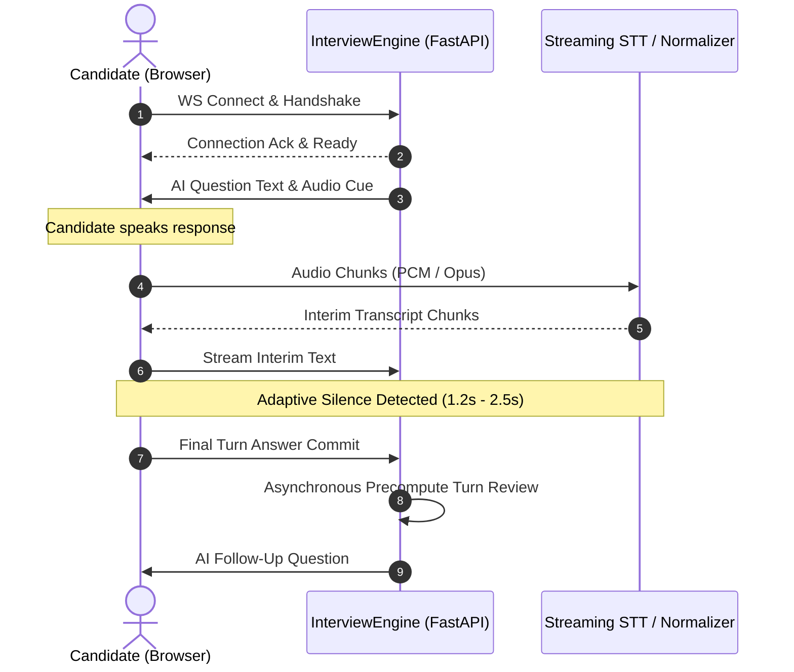

# API Reference: InterviewForge

This document outlines the candidate-facing REST endpoints, WebSocket real-time protocols, and scoring schemas powering InterviewForge.

> [!NOTE]
> The full machine-readable OpenAPI 3.1.0 specification is available at [`docs/openapi.json`](file:///d:/Projects/Ai-mock-interview/adaptive-ai-mock-interview-platform/docs/openapi.json).

---

## 1. Authentication & Candidate Identity

All protected API endpoints require an `Authorization: Bearer <JWT_TOKEN>` header.

### 1.1 Candidate Registration
- **Endpoint**: `POST /api/v1/auth/register`
- **Rate Limit**: 5 requests / 60 seconds
- **Request Payload**:
  ```json
  {
    "email": "candidate@example.com",
    "full_name": "Jane Doe",
    "password": "SecurePassword123!"
  }
  ```
- **Response**: `201 Created`
  ```json
  {
    "id": "6724a8...",
    "email": "candidate@example.com",
    "full_name": "Jane Doe",
    "created_at": "2026-11-04T12:00:00Z"
  }
  ```

### 1.2 Candidate Login
- **Endpoint**: `POST /api/v1/auth/login`
- **Rate Limit**: 5 requests / 60 seconds
- **Request Payload**:
  ```json
  {
    "email": "candidate@example.com",
    "password": "SecurePassword123!"
  }
  ```
- **Response**: `200 OK`
  ```json
  {
    "access_token": "eyJhbGciOiJIUzI1Ni...",
    "token_type": "bearer",
    "user": {
      "id": "6724a8...",
      "email": "candidate@example.com",
      "full_name": "Jane Doe"
    }
  }
  ```

### 1.3 Identity Verification
- **Endpoint**: `GET /api/v1/auth/me`
- **Headers**: `Authorization: Bearer <TOKEN>`
- **Response**: `200 OK`

---

## 2. Interview Session Lifecycle

### 2.1 Create Interview Session
- **Endpoint**: `POST /api/v1/sessions`
- **Request Payload**:
  ```json
  {
    "role": "Distributed Systems Architect",
    "seniority": "Staff",
    "difficulty": "Adaptive",
    "max_questions": 5
  }
  ```
- **Response**: `201 Created`
  ```json
  {
    "id": "session-f3b12...",
    "user_id": "6724a8...",
    "role": "Distributed Systems Architect",
    "seniority": "Staff",
    "status": "CREATED",
    "created_at": "2026-11-04T12:01:00Z"
  }
  ```

### 2.2 Start Interview (Question 1 Generation)
- **Endpoint**: `POST /api/v1/interview/sessions/{session_id}/start`
- **Response**: `200 OK`
  ```json
  {
    "session_id": "session-f3b12...",
    "status": "IN_PROGRESS",
    "current_question_index": 1,
    "max_questions": 5,
    "next_question": "Can you describe how you design for high availability across multi-region cloud deployments?",
    "tts_audio_url": null
  }
  ```

### 2.3 Resumption & Reload State
- **Endpoint**: `GET /api/v1/interview/sessions/{session_id}/state`
- **Purpose**: Restores in-flight interview session on browser refresh or accidental disconnection.
- **Response**: `200 OK`
  ```json
  {
    "session_id": "session-f3b12...",
    "status": "IN_PROGRESS",
    "current_question_index": 3,
    "max_questions": 5,
    "current_question": "How do you manage partition rebalancing in Apache Kafka without inducing consumer group lag spikes?",
    "completed_turns_count": 2
  }
  ```

### 2.4 Submit Turn Answer
- **Endpoint**: `POST /api/v1/interview/sessions/{session_id}/answer`
- **Rate Limit**: 60 requests / 60 seconds
- **Request Payload**:
  ```json
  {
    "answer": "We adopted cooperative sticky assignors in our Kafka consumer configurations...",
    "source": "voice",
    "stt_confidence": 0.96
  }
  ```
- **Response**: `200 OK`
  ```json
  {
    "status": "IN_PROGRESS",
    "current_question_index": 4,
    "next_question": "What telemetry metrics do you monitor to detect impending broker degradation?"
  }
  ```

### 2.5 End Interview Session
- **Endpoint**: `POST /api/v1/interview/sessions/{session_id}/end`
- **Request Payload**: `{"reason": "user_ended"}`
- **Response**: `200 OK`
  ```json
  {
    "status": "COMPLETED",
    "session_id": "session-f3b12...",
    "completed_turns": 5
  }
  ```

---

## 3. Executive Review & Scorecard API

### 3.1 Trigger Asynchronous Report Generation
- **Endpoint**: `POST /api/v1/sessions/{session_id}/report/generate`
- **Response**: `200 OK` (Begins async worker synthesis or retrieves cached report)

### 3.2 Poll Generation Progress
- **Endpoint**: `GET /api/v1/sessions/{session_id}/report/status`
- **Response**: `200 OK`
  ```json
  {
    "session_id": "session-f3b12...",
    "status": "completed",
    "step": "Executive Scorecard Ready",
    "progress": 1.0,
    "updated_at": "2026-11-04T12:22:15Z"
  }
  ```

### 3.3 Retrieve Detailed Report Document
- **Endpoint**: `GET /api/v1/sessions/{session_id}/report`
- **Response Model**: `InterviewReport` (Schema 2.0 with automatic Schema 1.0 bidirectional translation)
- **Top-Level Sections**:
  - `role`: Role title, level, and competencies evaluated
  - `overview`: Overall score (0-100), verdict (`Strong Hire`, `Hire`, `Leaning Hire`, `No Hire`), executive summary
  - `skills`: Radar/breakdown of Technical Competency, Communication, and Integrity
  - `turns`: Array of questions, complete candidate transcripts, scored dimensions, and actionable critique
  - `action_plan`: 7-day targeted improvement plan and top priorities
  - `readiness`: Deterministic hiring readiness index

---

## 4. Real-time WebSocket Protocol

Endpoint: `ws://<HOST>/ws/interview/{session_id}?token=<JWT>`

### Message Sequence Diagram



### Supported WebSocket Message Types
1. **`turn_audio_chunk`**: Binary or base64 audio frames sent by candidate.
2. **`transcript_interim`**: Incremental speech recognition hypotheses displayed in live caption drawer.
3. **`transcript_final`**: Sealed turn transcription passed to the evaluation pipeline.
4. **`telemetry_heartbeat`**: Face-mesh presence and audio volume RMS values for integrity verification.
5. **`turn_complete`**: Confirmation that turn answer was received and stored.

---

## 5. System Health Probes

| Endpoint | Method | Expected Code | Payload |
| :--- | :--- | :--- | :--- |
| `/health` | GET | `200 OK` | `{"status": "ok"}` |
| `/health/db` | GET | `200 OK` / `503` | `{"status": "ok", "database": "ai-mock-interview", "latency_ms": 3.4}` |
| `/api/v1/ping` | GET | `200 OK` | `{"ping": "pong"}` |

