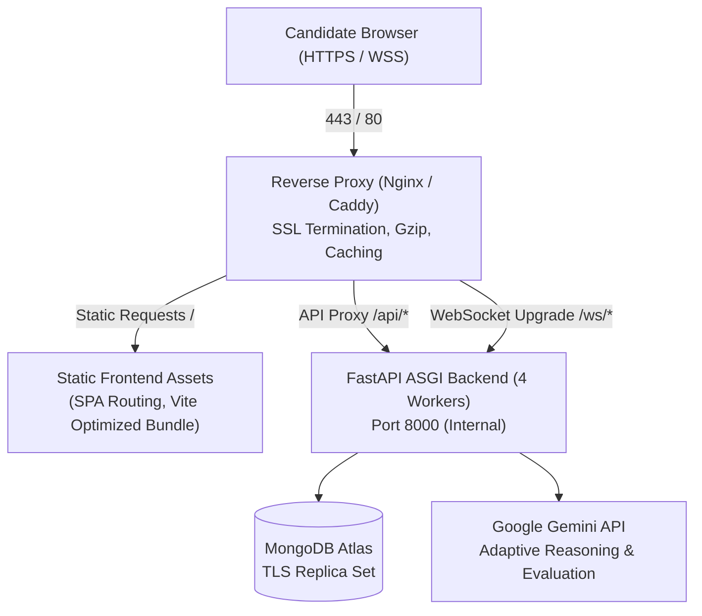

# Production Deployment Guide: InterviewForge

This guide provides step-by-step instructions for deploying InterviewForge to a production single-node Linux VPS (Ubuntu 22.04 / 24.04 LTS) or cloud container environment using Docker Compose, reverse proxy SSL termination (Nginx / Caddy), MongoDB Atlas, and production ASGI worker orchestration.

---

## 1. System Architecture Overview



- **Frontend**: Pre-compiled React + Vite static bundle served with immutable browser caching headers and single-page routing fallbacks.
- **Backend**: FastAPI ASGI application powered by Uvicorn multi-worker process management, correlation ID propagation, and strict sliding-window rate limiting.
- **Database**: MongoDB Atlas M0 (Free Tier) or M10+ dedicated cluster over TLS with authenticated connection string.
- **Reverse Proxy**: Nginx or Caddy handling automated TLS certificates, HTTP/2, and persistent bidirectional WebSocket upgrades.

---

## 2. Infrastructure & System Requirements

- **Operating System**: Ubuntu 22.04 LTS or 24.04 LTS
- **Hardware Minimum**: 2 vCPUs, 4 GB RAM, 20 GB SSD
- **Hardware Recommended**: 4 vCPUs, 8 GB RAM, 40 GB NVMe SSD
- **Network Ports**:
  - `80/tcp` (HTTP - ACME challenge / redirect)
  - `443/tcp` (HTTPS / WSS)
  - `22/tcp` (SSH)

---

## 3. Host Hardening & Firewall Configuration

### 3.1 Linux Packages & Docker Installation
```bash
# Update package repositories
sudo apt-get update && sudo apt-get upgrade -y

# Install essential dependencies
sudo apt-get install -y curl git ufw fail2ban ca-certificates gnupg lsb-release

# Install Docker Engine and Docker Compose Plugin
sudo install -m 0755 -d /etc/apt/keyrings
curl -fsSL https://download.docker.com/linux/ubuntu/gpg | sudo gpg --dearmor -o /etc/apt/keyrings/docker.gpg
sudo chmod a+r /etc/apt/keyrings/docker.gpg

echo \
  "deb [arch=$(dpkg --print-architecture) signed-by=/etc/apt/keyrings/docker.gpg] https://download.docker.com/linux/ubuntu \
  $(lsb_release -cs) stable" | sudo tee /etc/apt/sources.list.d/docker.list > /dev/null

sudo apt-get update
sudo apt-get install -y docker-ce docker-ce-cli containerd.io docker-buildx-plugin docker-compose-plugin

# Enable non-root docker access (optional)
sudo usermod -aG docker $USER
```

### 3.2 UFW Firewall Rules
```bash
# Set default policies
sudo ufw default deny incoming
sudo ufw default allow outgoing

# Allow SSH and Web traffic
sudo ufw allow 22/tcp comment 'SSH'
sudo ufw allow 80/tcp comment 'HTTP ACME / Redirect'
sudo ufw allow 443/tcp comment 'HTTPS Production'

# Enable firewall
sudo ufw --force enable
sudo ufw status verbose
```

---

## 4. MongoDB Atlas Setup & Index Verification

1. **Create an Atlas Cluster**:
   - Create an M0 (Shared) or M10 (Dedicated) cluster in your preferred region.
2. **Configure Database User**:
   - Create a database user with `readWrite` access to the `ai-mock-interview` database.
3. **Network Access / IP Whitelisting**:
   - Add your VPS public static IP address to the Atlas Network Access list.
4. **Copy TLS Connection String**:
   - The connection string will follow the format:
     `mongodb+srv://<USER>:<PASSWORD>@<CLUSTER>.mongodb.net/ai-mock-interview?retryWrites=true&w=majority`
5. **Idempotent Index Creation**:
   - The backend automatically initializes and verifies all indexes on startup (`app/core/database.py`).
   - Covered collections:
     - `auth`: `email` (unique), `created_at`
     - `interview_sessions`: `(user_id, started_at)`, `session_status`
     - `evaluations`: `session_id` (unique)
     - `report_status`: `session_id` (unique), `updated_at`
     - `telemetry_samples`: `(session_id, bucket_start)`
     - `integrity_events`: `(session_id, t)`
     - `resumes`: `(user_id, created_at)`
     - `resume_chunks`: `(user_id, resume_id)`

---

## 5. Environment Variables & Secret Generation

Generate cryptographically secure tokens before deploying:

```bash
# Generate high-entropy JWT signing secret (minimum 32 bytes / 64 hex characters)
openssl rand -hex 32

# Generate session cookie signing key
openssl rand -hex 32
```

Clone the repository and create `.env.production`:

```bash
git clone https://github.com/your-org/adaptive-ai-mock-interview-platform.git
cd adaptive-ai-mock-interview-platform

# Create production environment configuration file
cp .env.example .env.production
chmod 600 .env.production
```

Populate `.env.production` with your live configuration:

```ini
# Application Mode
ENVIRONMENT=production
DEBUG=false
APP_NAME=InterviewForge

# Server Binding
HOST=0.0.0.0
PORT=8000

# Security & Authentication (Strict Production Validation Enforced)
JWT_SECRET=<PASTE_OUTPUT_FROM_OPENSSL_RAND_HEX_32>
JWT_ALGORITHM=HS256
ACCESS_TOKEN_EXPIRE_MINUTES=60
COOKIE_SECURE=true
CORS_ORIGINS=["https://interviewforge.yourdomain.com"]

# Database Configuration (MongoDB Atlas)
MONGODB_URI=mongodb+srv://<DB_USER>:<DB_PASS>@<CLUSTER_HOST>/ai-mock-interview?retryWrites=true&w=majority
MONGODB_DB_NAME=ai-mock-interview

# AI Model Configuration (Gemini API)
GEMINI_API_KEY=<YOUR_LIVE_GEMINI_API_KEY>
PRIMARY_LLM_MODEL=gemini-3.5-flash-lite
FALLBACK_LLM_MODEL=gemini-2.5-flash

# Speech-to-Text & Realtime Limits (PR4 Hardened)
MAX_ANSWER_SEC=300
ANSWER_SOFT_WARNING_SEC=240
MAX_ANSWER_CHARS=30000
WS_MAX_MESSAGE_BYTES=262144
MAX_TRANSCRIPT_CHARS_PER_TURN=30000
```

> [!CAUTION]
> The backend startup checks enforce fail-fast security validation:
> 1. If `JWT_SECRET` is shorter than 32 characters or uses known development placeholders, backend refuses to boot.
> 2. If `CORS_ORIGINS` contains wildcard `*` while `ENVIRONMENT=production`, backend refuses to boot.

---

## 6. Docker Compose Deployment

Run the production containers:

```bash
# Build and launch production containers in detached mode
docker compose -f docker-compose.prod.yml up -d --build

# Verify running container status and health
docker compose -f docker-compose.prod.yml ps
```

Expected output:
```text
NAME                         IMAGE               COMMAND                  SERVICE    STATUS
interviewforge_prod_backend  ...-backend         "uvicorn app.main:ap…"   backend    running (healthy)
interviewforge_prod_frontend ...-frontend        "nginx -g 'daemon of…"   frontend   running
```

---

## 7. Reverse Proxy & SSL Termination

### Option A: Caddy (Recommended for Zero-Maintenance HTTPS)

Caddy handles automatic certificate issuance and renewal via Let's Encrypt / ZeroSSL.

1. Ensure domain DNS `A` record points to your VPS IP.
2. Edit `Caddyfile` with your domain:
   ```caddy
   interviewforge.yourdomain.com {
       encode zstd gzip

       handle /api/* {
           reverse_proxy localhost:8000
       }

       handle /ws/* {
           reverse_proxy localhost:8000
       }

       handle /health* {
           reverse_proxy localhost:8000
       }

       handle {
           root * /var/www/interviewforge/frontend/dist
           try_files {path} /index.html
           file_server
       }
   }
   ```
3. Run Caddy:
   ```bash
   sudo caddy reload --config Caddyfile
   ```

### Option B: Nginx + Certbot

1. Install Certbot:
   ```bash
   sudo apt-get install -y certbot python3-certbot-nginx
   ```
2. Obtain SSL certificate:
   ```bash
   sudo certbot --nginx -d interviewforge.yourdomain.com
   ```
3. Copy `nginx/nginx.conf` to `/etc/nginx/sites-available/interviewforge` and enable it:
   ```bash
   sudo ln -s /etc/nginx/sites-available/interviewforge /etc/nginx/sites-enabled/
   sudo nginx -t && sudo systemctl reload nginx
   ```

---

## 8. Health Check & Validation

Test all live health endpoints using `curl`:

```bash
# Liveness probe
curl -i https://interviewforge.yourdomain.com/health

# Database connectivity probe (Redacted credentials)
curl -i https://interviewforge.yourdomain.com/health/db

# API v1 Ping
curl -i https://interviewforge.yourdomain.com/api/v1/ping
```

Expected HTTP response: `200 OK`
```json
{"status": "ok"}
```

---

## 9. Zero-Downtime Rolling Update Procedure

When pushing a new release or hotfix to production:

```bash
# 1. Pull latest release commit
git pull origin main

# 2. Build updated images
docker compose -f docker-compose.prod.yml build

# 3. Perform rolling reload on backend service
docker compose -f docker-compose.prod.yml up -d --no-deps --build backend

# 4. Wait for backend healthcheck to turn healthy
while [ "$(docker inspect --format='{{.State.Health.Status}}' interviewforge_prod_backend)" != "healthy" ]; do
    echo "Waiting for backend healthy state..."
    sleep 2
done

# 5. Reload frontend / nginx container
docker compose -f docker-compose.prod.yml up -d --no-deps frontend

echo "Rolling update completed successfully!"
```

---

## 10. Database Backup & Restore Operations

Automated backups can be scheduled via `cron`:

```bash
# Run manual backup
./scripts/backup_restore.sh backup

# Schedule nightly backup at 02:00 AM UTC
crontab -e
# Add line:
# 0 2 * * * cd /opt/interviewforge && ./scripts/backup_restore.sh backup >> /var/log/interviewforge_backup.log 2>&1
```

To restore from an archive:
```bash
./scripts/backup_restore.sh restore ./backups/interviewforge_backup_20261104_120000.archive.gz
```

