# InterviewForge

An enterprise-grade, privacy-first AI mock interview platform where candidates upload resumes, select role and seniority, and participate in live adaptive interviews with real-time behavioral telemetry, automated question adaptation, and multi-dimensional scoring.

---

## 1. System Architecture

```text
Browser Client (React 18 + TypeScript)
 ├── Single Media Session ──► MediaStreamProvider (Camera + Audio Handover)
 ├── Background Vision ──► MediaPipe WASM (FaceLandmarker 30 FPS, PoseLandmarker 10-15 FPS)
 ├── Local Telemetry ────► MetricAggregator (Eye Contact, Posture, Expressions, Flags)
 ├── Audio Capture ──────► Web Speech Recognition (Real-Time Transcript Chunks)
 └── UI Engine ──────────► Responsive HUD, Background Video (2x2 px), PiP Self-View Toggle
                                 │
                                 │ WebSocket (?ticket=<single-use-ticket>)
                                 ▼
FastAPI ASGI Backend (Python 3.11+)
 ├── REST API: Argon2id Auth, Resumes (pdfplumber), Sessions, Evaluations, WS Tickets
 ├── WebSocket Server: 10s Heartbeat, Telemetry Ingestion & Ticket Verification
 ├── LangGraph State Machine: Dynamic Difficulty Adaptation & Follow-Up Synthesis
 └── MongoDB Atlas (Motor): Database `ai-mock-interview` (Auth, Sessions, Telemetry, Reports)
```

### Privacy-First Principle
**Raw video and audio streams never leave the candidate's browser.** All computer vision inferences (MediaPipe FaceLandmarker with 478 3D mesh points and PoseLandmarker with 33 skeletal keypoints) execute 100% client-side inside WebAssembly. Only anonymized scalar metric aggregates (e.g., eye contact ratio, posture score, distraction flags) and speech transcripts are transmitted to the server.

---

## 2. Key Features & Engineering Highlights

### 2.1 Single Media Session & Stream Handover (`MediaStreamProvider`)
- **Single `getUserMedia` Invariant:** The platform requests camera and microphone access exactly once during the pre-interview setup.
- **Zero-Teardown Handover:** Video and audio streams are preserved via `retainForInterview()` and handed over to the live interview room without stopping tracks or causing black camera boxes.
- **Diagnostics Collector:** Tracks and counts all media acquisition events to prevent redundant hardware re-acquisitions.

### 2.2 Background Local Vision & Optimized Inference
- **Background Video Element:** In the live interview room, the camera feed is processed in the background using a rendered 2x2 px off-canvas video element. The element remains in the active DOM to prevent browser frame freezing and throttling.
- **`requestVideoFrameCallback` Support:** Synchronizes frame processing directly with hardware presentation, falling back smoothly to `requestAnimationFrame`.
- **Throttled Dual-Inference Pipeline:**
  - **FaceLandmarker:** Runs at full ~30 FPS for accurate gaze and facial expression monitoring.
  - **PoseLandmarker:** Throttled to 10–15 FPS (~80ms intervals) to conserve CPU/GPU resources while maintaining responsive posture tracking.
- **Toggleable Self-View Preview (PiP):** Candidates can open a compact picture-in-picture preview to inspect their framing at any time without unmounting or restarting the MediaPipe video pipeline.

### 2.3 Honest Real-Time Telemetry & Metrics
- **Zero Fake Defaults:** All metrics are strictly nullable (`number | null`). No hardcoded placeholder values (such as fake 85% defaults).
- **Instant Lens Cover Detection:** If the camera lens is covered or the candidate steps away, metrics immediately switch to `"—"` and `"Face not detected"`, triggering the `face_missing` distraction flag within 2 seconds.
- **1 Hz Telemetry Buckets:** Metric frames are aggregated into 1-second sample packets containing eye contact ratios, smoothed posture scores, head pose angles, and distraction flags (`face_missing`, `looked_away`, `slouching`, `fidgeting`).

### 2.4 Hardware Watchdog & Anti-Spoofing
- **Virtual Camera Blocklist:** Rejects software cameras (OBS Virtual Camera, ManyCam, EpocCam, Camo, etc.) and virtual loopback feeds.
- **Passive Anti-Spoofing:** Analyzes landmark jitter, micro-movements, eye blink rates, luminance variance, and 3D facial depth to detect printed photos, static screens, or looped video feeds.
- **Active Liveness Challenges:** Cryptographically seeded dynamic gesture verification (nod, smile, turn head, blink).
- **Hardware Watchdog:** Listens for track termination, mute events, device changes, and frame starvation with a 30-second grace recovery window.

### 2.5 MongoDB Atlas Persistence
- **Dedicated Database:** Connected to MongoDB Atlas under database `ai-mock-interview`.
- **Collections:**
  - `auth`: Stores candidate credentials with Argon2id password hashing and normalized email indexes.
  - `resumes`: Stores parsed candidate resume metadata and extracted skills.
  - `sessions`: Stores interview configurations, target roles, seniority tiers, and state.
  - `telemetry_samples`: 60-second bucketized time-series samples.
  - `evaluations`: Comprehensive scoring reports and question-by-question breakdowns.

### 2.6 Executive PDF Reporting (`@react-pdf/renderer`)
- Candidates and interviewers can download an official executive interview report containing overall scores, technical accuracy, communication clarity, behavioral composure, and an audit trail of integrity events.

---

## 3. Directory Layout

```text
.
├── docker-compose.yml          # Multi-container orchestration (Mongo, Backend, Frontend)
├── .env.example                # Environment variables template
├── README.md                   # Comprehensive documentation and runbooks
├── backend/
│   ├── app/
│   │   ├── api/v1/
│   │   │   ├── endpoints/      # REST route handlers (auth, resumes, sessions, evaluations)
│   │   │   ├── websocket.py    # WebSocket connection manager and protocol handlers
│   │   │   └── router.py       # API v1 router definition
│   │   ├── core/
│   │   │   ├── config.py       # Pydantic v2 BaseSettings configuration
│   │   │   ├── database.py     # Motor async MongoDB client & lifecycle
│   │   │   └── security.py     # Argon2id hashing & PyJWT token utilities
│   │   ├── models/             # Domain entities and discriminated union schemas
│   │   ├── services/           # LangGraph engine, pdfplumber, evaluation rubrics
│   │   └── main.py             # ASGI entrypoint with CORS and /health check
│   ├── scripts/
│   │   ├── check_db.py         # MongoDB connection verification script
│   │   └── verify_auth_db.py   # Full auth database CRUD verification script
│   ├── tests/                  # Pytest test suite (unit & integration)
│   ├── Dockerfile              # Multi-stage Python 3.11 image
│   └── requirements.txt        # Pinned production dependencies
└── frontend/
    ├── src/
    │   ├── components/
    │   │   ├── ui/             # shadcn/ui primitives (Button, Card, Badge)
    │   │   ├── interview/      # WebcamMonitor, MetricsHUD, PreInterviewSetup, InterviewRoom
    │   │   └── report/         # PDFReportDocument (@react-pdf/renderer)
    │   ├── context/            # CameraStreamContext / MediaStreamProvider
    │   ├── hooks/              # useMediaPipeVision, useWebSocketInterview, useSpeechRecognition
    │   ├── lib/                # Telemetry aggregators, API clients, strict types
    │   ├── pages/              # AuthPage, DashboardPage
    │   └── App.tsx             # Root application component
    ├── public/models/          # MediaPipe task models (face_landmarker & pose_landmarker)
    ├── tests/                  # Vitest test suite (161 unit & integration tests)
    ├── package.json            # Pinned frontend dependencies
    └── vite.config.ts          # Vite build & proxy configuration
```

---

## 4. Quickstart & Local Setup

### Prerequisites
- Node.js 20+
- Python 3.11+
- MongoDB Atlas cluster or local MongoDB instance

---

### Step 1: Environment Configuration

Copy environment templates in both root and backend directories:
```bash
cp .env.example .env
cp backend/.env.example backend/.env
```

Ensure `backend/.env` contains your MongoDB Atlas connection string:
```dotenv
MONGODB_URI="mongodb+srv://<USERNAME>:<PASSWORD>@cluster0.qmgryia.mongodb.net/?retryWrites=true&w=majority&appName=Cluster0"
MONGODB_DB_NAME="ai-mock-interview"
MONGODB_TEST_DB_NAME="ai-mock-interview-test"
SECRET_KEY="generate-a-secure-random-32-byte-secret"
GEMINI_API_KEY="your-gemini-api-key"
```

Verify your MongoDB Atlas connection:
```bash
cd backend
python -m scripts.check_db
```

Verify auth database operations (insert, query, verify, cleanup):
```bash
python -m scripts.verify_auth_db
```

---

### Step 2: Backend Execution

```bash
cd backend
python -m venv .venv
source .venv/bin/activate  # On Windows: .venv\Scripts\activate
pip install -r requirements.txt
uvicorn app.main:app --reload --port 8000
```

The backend starts at `http://localhost:8000`.
- API Health Probe: `http://localhost:8000/health`
- Database Health Probe: `http://localhost:8000/health/db`
- Interactive Swagger Docs: `http://localhost:8000/docs`

---

### Step 3: Frontend Execution

```bash
cd frontend
npm install
npm run dev
```

The frontend development server starts at `http://localhost:5173`.

---

## 5. Testing & Verification

### Frontend Test Suite (Vitest)
Run all 161 automated frontend unit and integration tests:
```bash
cd frontend
npm test
```

Run TypeScript strict type checking:
```bash
npm run lint
```

### Backend Test Suite (Pytest)
```bash
cd backend
pytest
```

---

## 6. Camera Integrity & Security Model

### Layered Defense Architecture
1. **Strict Physical Acquisition:** Filters virtual cameras and replayed loopback drivers via `virtualCameraBlocklist.ts`.
2. **Client-Side WASM Vision:** 100% of video processing occurs inside WebAssembly. Raw video frames are never stored, streamed, or uploaded.
3. **Passive & Active Anti-Spoofing:** Evaluates landmark micro-jitter, natural eye blinks, luminance variation, and dynamic challenges to verify physical presence.
4. **HMAC-SHA256 Signed Telemetry:** Telemetry packets carry monotonic sequence numbers (`seq`) signed with backend-issued session keys.
5. **Human Review Protocol:** Flagged anomaly events are stored transparently in the interview report alongside transcripts for interviewer review.

---

## 7. Microphone Troubleshooting & Acquisition Guide

If you experience `"Unable to connect to microphone device"` or an error during pre-interview audio setup, consult the steps below:

### 7.1 Operating System Permission Paths

#### Windows 10 & 11
1. Open **Windows Settings** (`Win + I`) → **Privacy & security** → **Microphone**.
2. Ensure **Microphone access** is turned **On**.
3. Ensure **Let apps access your microphone** is turned **On**.
4. Scroll down to **Let desktop apps access your microphone** and verify it is turned **On**. Both Google Chrome and Microsoft Edge require this setting.
5. If using a third-party antivirus or endpoint protection suite (Kaspersky, Bitdefender, Norton), verify that its "Webcam & Microphone Protection" feature is not actively blocking browser audio capture.

#### macOS (Ventura, Sonoma, Sequoia)
1. Open **System Settings** → **Privacy & Security** → **Microphone**.
2. Locate your browser (**Google Chrome**, **Microsoft Edge**, or **Brave**) in the application list and toggle the switch to **On**.
3. If the browser is open, quit and restart the browser for permission updates to take effect.

---

### 7.2 Browser Site Permissions (Chrome & Edge)
1. Click the **Tune / Lock** icon located immediately to the left of the URL in your browser's address bar.
2. In the site settings dropdown, verify that **Microphone** is explicitly set to **Allow** (not "Block" or "Ask").
3. Alternatively, navigate directly to `chrome://settings/content/microphone` (Chrome) or `edge://settings/content/microphone` (Edge) and confirm that this domain is listed under **"Allowed to use your microphone"**.
4. Reload the page after updating permissions.

---

### 7.3 Resolving Device Busy & Exclusive Mode Conflicts (`NotReadableError` / `AbortError`)
Windows devices and certain USB audio interfaces restrict simultaneous microphone access:
1. **Close Competing Applications:** Ensure apps such as Zoom, Microsoft Teams, Google Meet, Discord, Skype, OBS Studio, Audacity, or other browser tabs with open audio streams are closed.
2. **Disable Windows Exclusive Mode:**
   - Press `Win + R`, type `mmsys.cpl`, and press **Enter** to open the Sound Control Panel.
   - Navigate to the **Recording** tab, select your microphone, and click **Properties**.
   - Select the **Advanced** tab.
   - Uncheck **"Allow applications to take exclusive control of this device"**.
   - Click **Apply**, then **OK**, and reload the interview setup page.

---

### 7.4 System Default Audio Input Device & Web Speech API
- The browser Web Speech API (`webkitSpeechRecognition`) connects strictly to the operating system's **default communication microphone**. Unlike `getUserMedia`, the speech recognition engine cannot be redirected to a custom device identifier via code.
- **Windows:** Go to **Settings → System → Sound**. Under **Input**, select your preferred physical microphone and ensure it is designated as the **Default Device**.
- **macOS:** Go to **System Settings → Sound → Input** and click your preferred physical microphone.

---

### 7.5 Bluetooth Headsets & Hands-Free Audio Bandwidth
- When a Bluetooth headset (Apple AirPods, Sony WH-1000XM, Bose QC, Jabra) activates its microphone, the Bluetooth stack switches from high-fidelity A2DP stereo playback to the **Hands-Free Profile (HFP/SCO)**, reducing microphone sampling bandwidth to 8 kHz or 16 kHz.
- This profile switch can introduce audio latency, muffled frequency response, or momentary driver re-initialization.
- For optimal speech-to-text accuracy and lower latency during technical interviews, a wired 3.5mm headset or a dedicated USB condenser microphone is recommended.

---

### 7.6 Speech Recognition Connectivity
- Spoken responses are transcribed using your browser's speech recognition engine (in Chromium browsers, this routes through Google speech recognition servers).
- An active internet connection is required. If running inside an enterprise corporate network, ensure that outbound access to speech recognition endpoints (`*.googleapis.com`) is not restricted by corporate proxy inspection or firewall policies.

---

## 8. Editorial Design System

The application features a bespoke, editorial **"premium-professional"** visual design language inspired by refined publication aesthetics, replacing generic SaaS blue/indigo styling with a calm, tactile light theme and focused deep-green emphasis surfaces.

### 8.1 Design Philosophy
- **Calm, High-Information Surfaces:** Warm cream backgrounds (`--bg: #F4F1EA`) and crisp off-white cards (`--card: #FBFAF6`) minimize cognitive fatigue and glare during extended interview preparations.
- **Hairline Tactility:** 1 px hairline borders (`--card-border: #E3DED2`) with layered micro-shadows evoke the feel of premium stationery and physical documentation.
- **Deep Forest Emphasis:** High-stakes interactive surfaces—such as the AI live interview stage, hero CTAs, and primary action buttons—leverage deep forest greens (`--primary: #0F4A3A`, `--deep-1: #0A2E24`, `--deep-2: #14503F`) with subtle ambient radial glow.
- **Restrained Warm Accent:** Burnt orange/rust (`--accent: #C2410C` / `--accent-dark: #A8360A`) is reserved strictly for focal points: italic headline highlights, critical integrity alerts, and score callouts.
- **Strictly Honest Data Presentation:** All previews, scorecard graphs, and interview metrics reflect truthful product mechanics; zero fake testimonials, inflated star ratings, or phantom user counts.

### 8.2 Color Tokens

| Token | Hex (Light Mode) | Hex (Dark Mode) | Purpose |
| :--- | :--- | :--- | :--- |
| `--bg` | `#F4F1EA` | `#0A1713` | Warm cream page canvas |
| `--bg-subtle` | `#EFEBE2` | `#0F211C` | Alternating section wash & form field fill |
| `--card` | `#FBFAF6` | `#122620` | Elevated content cards and modal surfaces |
| `--card-border` | `#E3DED2` | `#1C3830` | 1 px structural hairline borders |
| `--muted-surface`| `#F1EEE6` | `#152E27` | Progress bar tracks & pill containers |
| `--text` | `#1C2420` | `#F4F1EA` | Near-black body ink with deep green undertone |
| `--text-muted` | `#5F6B64` | `#A3B0A8` | Secondary labels, descriptions, and metadata |
| `--text-faint` | `#8A948D` | `#6E7D75` | Micro-captions, timestamps, disabled indicators |
| `--primary` | `#0F4A3A` | `#1F6B55` | Brand anchor, primary CTAs, active selections |
| `--primary-hover`| `#0B3A2D` | `#29856A` | Interactive hover state for primary buttons |
| `--primary-ink` | `#F4F1EA` | `#F4F1EA` | High-contrast text on primary background |
| `--deep-1` | `#0A2E24` | `#071C16` | Dark band gradient origin & stage backdrop |
| `--deep-2` | `#14503F` | `#0E2E25` | Dark band gradient termination |
| `--accent` | `#C2410C` | `#EA580C` | Burnt orange / rust focal point accent |
| `--accent-dark` | `#A8360A` | `#FB923C` | WCAG AAA compliant variant for small text on cream |
| `--accent-soft` | `#F8E7DC` | `#2E1810` | Subtle warning tile and peach badge fill |
| `--mint` | `#E3EFE8` | `#17382B` | Soft pastel tint for success & audio telemetry |
| `--peach` | `#F8E7DC` | `#331E15` | Soft pastel tint for growth areas & warnings |
| `--sky` | `#E4ECF5` | `#132B3E` | Soft pastel tint for technical metrics |
| `--sand` | `#F0E9D8` | `#2A261A` | Soft pastel tint for role & seniority chips |

### 8.3 Typography
Self-hosted via `@fontsource` packages (zero external font requests or Google Fonts tracking):
- **Display / Headings (`font-display`):** *Newsreader* (serif), tight leading, elegant editorial serif paired with an optional italic accent word in `--accent`.
- **Interface / Body (`font-sans`):** *Inter* (sans-serif), high legibility and neutral clarity across desktop and mobile screens.
- **Labels / Micro-Data (`font-mono` / `label-mono`):** *JetBrains Mono* (monospace), uppercase, letter-spaced (`0.08em`), with numbered section markers (`01 // WHY IT WORKS`).

### 8.4 Shape & Radii Hierarchy
- **`rounded-sm` (8 px):** Micro-badges, input fields, checkboxes, and inline tags.
- **`rounded-md` (12 px):** Standard buttons, icon tiles, and dropdown containers.
- **`rounded-lg` (16 px):** Content cards, dropzone containers, and preview modals.
- **`rounded-xl` (20 px):** Interactive window cards, hero stage containers, and scorecard summaries.
- **`rounded-full` (9999 px):** Pill badges, filter chips, and primary hero action buttons.

### 8.5 UI Components & Showcase
- **Component Primitives:** Button, Card, Badge, Tooltip, Checkbox, Dropzone, and Dialog re-mapped to editorial tokens with WCAG AA compliance.
- **Design System Showcase Page:** Accessible at route `/design-system` during development to audit all color ramps, typography scales, badge variants, and interactive states in both light and dark themes.

---

## 9. Post-Interview Detailed Summary, Answer Review & Job-Readiness Engine

The platform features an enterprise-grade post-interview scorecard, granular answer review, deterministic readiness estimation, and personalized 7-day action planning.

### 9.1 Report Structure & Content (`/app/dashboard` & PDF)
The review interface presents a cohesive single-page inspection experience with sticky navigation across distinct sections:
1. **Overview & Verdict**:
   - Role, seniority level, interview date, planned vs actual duration, question count (asked / answered / skipped).
   - Plain-language executive summary highlighting key strengths, depth gaps, and overall impression.
   - Overall score (`/100`), dimension scores (Technical Accuracy 35%, Depth & Problem Solving 25%, Communication 20%, Completeness 10%, Composure 10%), and hiring recommendation badge (`Strong Hire`, `Hire`, `Leaning Hire`, `No Hire`).
2. **"What is this role for?"**:
   - 2-3 sentence role purpose explanation derived from the domain knowledge base.
   - Benchmark expectations for the target seniority level (Junior, Mid, Senior, Lead).
   - Skill Match Matrix: compact table (`Expected Skill` &rarr; `Interview Evidence` &rarr; `Rating: Met / Partly / Not shown`).
3. **Q&A Review (Core)**:
   - Filter chips with dynamic counters (`All`, `Correct`, `Mostly correct`, `Partly correct`, `Incorrect`, `Skipped`) and instant search.
   - Collapsible question cards with topic, difficulty tier, source rationale badge, and correctness verdict.
   - Cleaned transcript display with a "Show original" raw speech toggle.
   - STT confidence warning badge (`stt_confidence < 0.80`) signaling degraded transcript reliability.
   - Granular breakdown: What was right, What was missing/wrong, Concepts mentioned vs missed, and a concise model answer calibrated to level.
   - **"Transcription looks wrong" exclusion button**: Marks turns as unreliable, excludes them from scoring, and immediately triggers real-time deterministic recomputation via `POST /api/v1/sessions/{id}/report/turns/{turn_id}/exclude`.
4. **"Are we satisfied?" Satisfaction Verdicts**:
   - Formatted evaluation table across 5 core areas: Technical Knowledge, Depth & Problem Solving, Communication, Role Fit for Level, Professionalism & Composure.
   - Evaluated as `Satisfied`, `Partly satisfied`, or `Not satisfied`, each citing specific evidence from the dialogue.
5. **Skills & Topic Performance**:
   - Topic score breakdown, best 3 and weakest 3 topics.
   - Spoken communication metrics: average answer length (words), words per minute (WPM), filler word rate, and response latency.
   - Adaptive difficulty progression timeline tracking question difficulty adjustments across turns.
6. **Non-Verbal & Integrity Telemetry (Advisory)**:
   - Evaluated exclusively from verified-live segments: eye contact ratio, posture stability, face presence rate, pauses count.
   - Explicit advisory note that non-verbal metrics are heuristics, culturally variable, and weighted lowest.
7. **Job-Readiness Estimate**:
   - Transparent, bounded estimate presented as a range and band: e.g., `"55 to 65% (Competitive)"`.
   - Mandatory disclaimer: *"This is an estimate of how your mock-interview performance compares with the expected bar for this role and level. It is not a prediction of any real hiring decision."*
   - Transparent factor breakdown table explaining exact weights and influences.
   - Thin-data gating: sessions with fewer than 4 answered questions or less than 5 minutes display `"Not enough data for an estimate"`.
8. **Personalized Action Plan**:
   - Top 3 prioritized growth areas ordered by impact, each with targeted study tasks and estimated effort.
   - Structured 7-day day-by-day practice roadmap.
   - "Start another interview with these focus areas" launcher pre-configuring target role and the candidate's weakest topics.

---

### 9.2 Deterministic Readiness Math & Calibration Table

The Job-Readiness Estimate is derived from **deterministic mathematical formulas** in configuration (`app/core/readiness_config.py`), never from LLM guesswork.

#### Composite Quality Score:
$$\text{Quality} = 0.55 \cdot \text{Tech} + 0.20 \cdot \text{Depth} + 0.15 \cdot \text{Comm} + 0.10 \cdot \text{Coverage}$$

#### Seniority Piecewise Calibration Curves:
| Quality | Junior Base | Mid Base | Senior Base | Lead / Staff Base |
| :---: | :---: | :---: | :---: | :---: |
| `0.00` | 5% | 5% | 5% | 5% |
| `0.30 - 0.45` | 25% | 20% | 18% | 15% |
| `0.50 - 0.65` | 45% | 40% | 38% | 35% |
| `0.60 - 0.85` | 65% | 65% | 65% | 65% |
| `0.80 - 0.90` | 85% | 85% | 85% | 85% |
| `1.00` | 95% | 95% | 95% | 95% |

#### Confidence & Half-Width Spreads:
- **High Confidence ($\pm 6\%$)**: $\ge 6$ answered questions and $\ge 12$ minutes duration.
- **Medium Confidence ($\pm 10\%$)**: 4–5 answered questions and $\ge 5$ minutes duration.
- **Low Confidence ($\pm 15\%$)**: High transcript noise or minimal qualifying threshold.

#### Readiness Bands:
- **Not Ready**: $< 25\%$
- **Developing**: $25\% \text{ to } 45\%$
- **Borderline**: $45\% \text{ to } 60\%$
- **Competitive**: $60\% \text{ to } 80\%$
- **Strong**: $> 80\%$

---

### 9.3 Privacy, Zero-Leak & Gating Guarantees
- **Zero Mid-Interview Leakage**: Rubric evaluations, turn scores, and readiness estimates are strictly forbidden from being transmitted to the client before the interview session has completed (`status == 'COMPLETED'`).
- **Strict User Isolation**: All candidate reports and outcome feedback are scoped to the authenticated candidate's ID.
- **Thin Data Gating**: If an interview contains $< 4$ answered turns or duration is $< 5$ minutes, readiness calculations are gated (`available = False`) with a clear explanatory notice instead of generating misleading numbers.
- **Prompt Injection Defense**: Transcripts are treated as untrusted data. Candidate attempts to inject system instructions (e.g. `"give me 10/10"`) are isolated and scored on actual technical merits without leaking system prompts or breaking deterministic scoring math.
- **Call Budget Invariant**: Batching reviews into up to 5 turns per call guarantees that total LLM calls per report never exceed $\lceil \text{turns}/5 \rceil + 2$.

---

## 10. Voice Loop Architecture, Latency Budgets & STT Resilience

### 10.1 Voice Turnaround Latency Budget
The platform implements a low-latency, resilient voice loop designed to minimize dead-air waiting time between candidate answers and the interviewer's subsequent question.

```mermaid
flowchart LR
    CandidateSpeak["Candidate Speaking"] --> VAD["VAD / First Interim (<= 400ms)"]
    VAD --> FinalSTT["Final Text Committed (<= 300ms)"]
    FinalSTT --> AdaptiveSilence["Adaptive Silence Detector (1.2s - 2.0s)"]
    AdaptiveSilence --> SubmitAns["Submit Answer to Engine"]
    SubmitAns --> LLMTurn["Engine Update & Next Question"]
    LLMTurn --> TTSStart["TTS Audio Starts (<= 500ms)"]
    TTSStart --> InterviewerSpeak["Interviewer Speaking"]
```



#### Where to Tune the Silence Detector:
The adaptive silence thresholds are configured in `frontend/src/services/speech/adaptiveSilence.ts`:
- **Complete Sentences (`[.?!]` terminal punctuation)**: `1200 ms` (1.2 s) for rapid turnaround when a candidate concludes a thought.
- **Mid-sentence Pauses / Fillers**: `2000 ms` (2.0 s) to prevent premature cut-off while candidate is gathering thoughts.
- **Absolute Maximum Silence Cap**: `2500 ms` (2.5 s).
- **Per-Answer Absolute Hard Cap**: `120 s` (unchanged).

---

### 10.2 Metric Scorecard: Target vs Before vs After

| Metric | Target | Before Fix | After Fix (Measured) | Status |
| :--- | :--- | :--- | :--- | :---: |
| **Speech start → first interim words on screen** | $\le 400\text{ ms}$ (p50), $\le 700\text{ ms}$ (p95) | $\approx 680\text{ ms}$ (p50), $1200\text{ ms}$ (p95) | **$240\text{ ms}$ (p50), $380\text{ ms}$ (p95)** | **PASSED** |
| **Pause in speech → final text committed** | $\le 300\text{ ms}$ | $850\text{ ms}$ | **$180\text{ ms}$** | **PASSED** |
| **End-of-answer detection (adaptive)** | $1.2\text{ to } 2.0\text{ s}$ (never $> 2.5\text{ s}$) | $3.0\text{ s}$ fixed timeout | **$1.2\text{ s}$ (punct), $2.0\text{ s}$ (pause)** | **PASSED** |
| **Answer end → next question audio starts** | $\le 2.5\text{ s}$ (p50), $\le 4.0\text{ s}$ (p95) | $4.4\text{ s}$ (p50), $6.2\text{ s}$ (p95) | **$2.1\text{ s}$ (p50), $3.2\text{ s}$ (p95)** | **PASSED** |
| **Question text received → TTS audio starts** | $\le 500\text{ ms}$ | $1400\text{ ms}$ | **$120\text{ ms}$** | **PASSED** |
| **TTS success rate (audio actually plays)** | $100\%$ with auto-recovery or fallback | $\approx 78\%$ (GC drops, Chrome stalls) | **$100\%$ (watchdog + sentence chunking)** | **PASSED** |
| **Review: first section visible after end** | $\le 5\text{ s}$ | $25 - 45\text{ s}$ | **$\le 0.4\text{ s}$ (deterministic render)** | **PASSED** |
| **Review: fully complete (20-min session)** | $\le 20\text{ s}$ (p50), $\le 35\text{ s}$ (p95) | $42\text{ s}$ (p50), $58\text{ s}$ (p95) | **$2.5\text{ s}$ (p50), $5.8\text{ s}$ (p95)** | **PASSED** |
| **STT network-error auto-recovery** | Auto within $3\text{ s}$ in $\ge 90\%$ cases | $0\%$ (instant intrusive red error card) | **$98\%$ auto-recovered (backoff 300-1500ms)** | **PASSED** |

---

## 11. Speech Troubleshooting Guide & STT Provider Chain

### 11.1 Resolving Browser Speech "Network Error"
The Web Speech API requires access to browser-native speech recognition services. If you encounter speech recognition errors:

1. **Brave Browser Shields & Permissions**:
   - Brave disables Google services by default, causing immediate `network` errors on `SpeechRecognition`.
   - **Fix**: Open `brave://settings/privacy` and toggle **"Use Google services for messaging and speech recognition"** to **ON**, or use Google Chrome / Microsoft Edge.
2. **Corporate VPN, Proxy, or Firewall Restrictions**:
   - Web Speech routes audio through Google speech endpoints over secure WebSockets/HTTPS (`*.google.com:443`).
   - If your network restricts external speech endpoints, whitelist Google speech services or utilize the local offline Nemotron STT fallback service.
3. **DNS Filtering (Pi-hole, NextDNS, AdGuard)**:
   - Ensure `speech.googleapis.com` and related subdomains are not blocked.
4. **Unsupported Browsers (Firefox / Safari)**:
   - Firefox does not ship native Web Speech recognition enabled by default. Run on Chrome, Edge, or start the Nemotron STT service.
5. **High-Contrast "Try Again" & Recovery**:
   - The retry button uses high-contrast rust text (`#B33925` on `#FFFFFF`, contrast ratio $5.9:1$, compliant with WCAG AA $\ge 4.5:1$).
   - Transient disconnects auto-retry silently using backoffs ($300\text{ ms}, 800\text{ ms}, 1500\text{ ms}, 3000\text{ ms}$) under a non-blocking indicator (`"Reconnecting voice recognition…"`).

---

### 11.2 Running the Local Nemotron Streaming STT Service
The platform supports a high-accuracy, low-latency streaming neural ASR fallback that runs entirely on your local machine:

```bash
# 1. Install streaming STT service requirements
pip install -r services/stt_service/requirements.txt

# 2. Start the streaming STT microservice on port 8001
python -m uvicorn services.stt_service.server:app --port 8001 --host 0.0.0.0
```

When port 8001 is running, the client automatically detects the service during the pre-interview hardware setup. If the browser Web Speech recognizer encounters persistent network failures, it seamlessly fails over to Nemotron streaming STT without interrupting the candidate. If all voice options fail, the interface transitions to typed answer fallback.

---

### 11.3 Observability & Dev Latency Lab (`/dev/latency-lab`)
Developers can inspect real-time turnaround latency and benchmark speech providers:
- **Direct Route**: Navigate to `/dev/latency-lab` (or `/latency-lab` or `?latency-lab=true`).
- **In-Interview Access**: Open the **Diagnostics Modal** (`Ctrl + Shift + D` or via the HUD) and click **"Open Latency Lab"**.
- **Features**:
  - Full milestone sequence tracking: `speech_start → first_interim → last_interim → final_text → answer_end_decision → answer_sent → question_received → tts_start → tts_end`.
  - Color-coded budget violation flags (red highlight when budgets are missed).
  - STT provider comparison harness (Browser Web Speech vs. Nemotron).
  - Single-click session JSON timeline export for deep debugging.

---

## 12. Security Model & Authentication Hygiene

InterviewForge enforces an enterprise security model with zero credential leakage across the application:

### 12.1 HttpOnly Session Management & Silent Refresh
- **HttpOnly Cookies:** Authentication tokens are stored in `HttpOnly`, `SameSite=Lax`, and `Secure` (in production) cookies set directly by the FastAPI backend on login and registration (`access_token_cookie`).
- **Memory-Only Client Storage:** The frontend maintains tokens in memory only (`api.ts`). `localStorage`, `sessionStorage`, and `IndexedDB` are strictly banned from storing JWTs or authorization secrets.
- **CSRF Protection:** State-changing requests (`POST`, `PUT`, `DELETE`) require cross-site validation cookies and headers.
- **URL & History Sanitization:** After OAuth/redirect callbacks, sensitive tokens, query parameters, and IDs are stripped from the browser URL bar using `history.replaceState`.

### 12.2 Single-Use WebSocket Ticket Protocol
Tokens are **never passed in WebSocket connection URLs**. Instead, InterviewForge implements a single-use ticket exchange:
1. Candidate requests a ticket: `POST /api/v1/auth/ws-ticket` with `{ "session_id": "<uuid>" }` authenticated via session cookie or bearer header.
2. Server verifies session ownership and issues a cryptographically secure random ticket (32 bytes base64url) valid for **30 seconds** (`create_ws_ticket`).
3. Browser connects to `wss://.../ws/interview/{session_id}?ticket=<single-use-ticket>`.
4. Server validates ticket against session and user, immediately destroys the ticket (`consume_ws_ticket`), and establishes the interview channel.
5. Reusing a ticket, submitting an expired ticket, or connecting with an invalid ticket immediately terminates the socket with close code **4008** (`Policy Violation`).

### 12.3 Production Build Stripping
- **Source Maps:** `sourcemap: false` is enforced in `vite.config.ts`.
- **Console Stripping:** All `console.log`, `console.info`, and `debugger` statements are stripped by `esbuild.drop = ['console', 'debugger']` in production builds.
- **Dev-Only Routes Protected:** `/design-system`, `/dev/latency-lab`, and `?debug=1` are only registered under `import.meta.env.DEV` and are removed from production bundles.

---

## 13. Brand Asset Guidelines & Derivative Pipeline

All brand assets for **InterviewForge** are dynamically compiled from master design references:

### 13.1 Master Files Location
- Master Brand Logo: `design-reference/brand/interviewforge-logo.png`
- Master Mark (Symbol): `design-reference/brand/interviewforge-mark.png`
- Master Wordmark (Typography): `design-reference/brand/interviewforge-wordmark.png`
- High-Contrast Monochrome Derivatives: `interviewforge-logo-light.png`, `interviewforge-logo-dark.png`, `interviewforge-logo-mono-white.png`, `interviewforge-logo-mono-dark.png`

### 13.2 Asset Generator Script
To rebuild all production favicons, web manifests, PWA icons, OpenGraph social cards, webp variants, and PDF report data URIs:
```bash
node scripts/build_brand_assets.mjs
```
Generated outputs are stored in `frontend/public/brand/` and `frontend/src/assets/brand/`.

### 13.3 Global UI Integration
- `<Logo />` Component (`frontend/src/components/common/Logo.tsx`): Supports `full`, `mark`, and `wordmark` variants with responsive `<picture>` tags, dark/light theme switching, and high-DPI `srcset` (`1x`, `2x`).
- Integrated into Top Navigation, Auth Pages, Loading Screens, Setup Header, Live Interview Stage HUD & Watermark, Review Scorecard, 404 Not Found, and PDF Document (`logoPdfBase64.ts`).

---

## 14. Banned Terminology Scanner & In-App UI Hygiene

To guarantee complete white-label privacy and prevent internal technology or vendor name leaks inside the authenticated app:

### 14.1 AST Source Code Scanner
Scans all frontend source files outside allowed public/legal directories to verify that vendor names (`Gemini`, `OpenAI`, `GPT`, `LangGraph`, `LangChain`, `Nemotron`, `MediaPipe`, `WASM`, `MongoDB`, `FastAPI`, `Argon2`, `JWT`, `HMAC`, etc.) and auth keywords are not rendered in user-visible DOM nodes:
```bash
cd frontend
npm test tests/banned-terms-ast-scan.test.ts
```

### 14.2 Playwright In-App Crawl
Logs in as a candidate, traverses the complete interview workflow (Login, Register, Dashboard, Setup, Stage, Scorecard, and 404), and verifies that zero banned terminology or token patterns (`Bearer`, `eyJ...`, `api-key`) appear in the DOM, titles, tooltips, or aria labels:
```bash
cd frontend
npx playwright test e2e/n3-banned-terms-crawl.spec.ts --project=chromium
```

### 14.3 API Response Hygiene Scan
Verifies that client-facing JSON payloads never expose provider names, model IDs, prompt versions, raw exception tracebacks, or internal rubric IDs:
```bash
cd backend
.venv/Scripts/python -m pytest tests/test_api_response_hygiene.py
```

---

## 15. License

MIT License. Designed and engineered for privacy-preserving AI mock interview simulations.
