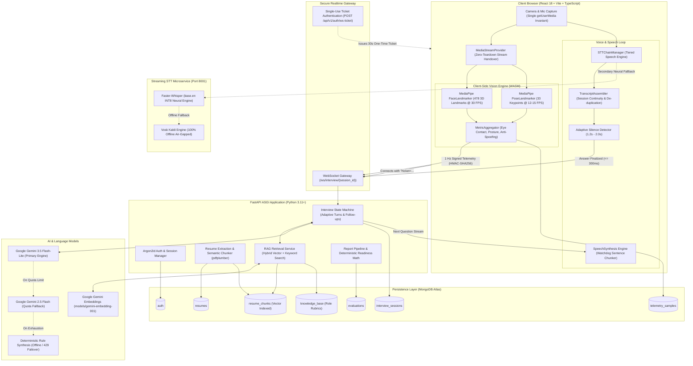

# InterviewForge

An enterprise-grade, privacy-first AI mock interview platform featuring real-time behavioral telemetry, automated dynamic question adaptation, hands-free conversational voice loop, and deterministic multi-dimensional job-readiness scoring.

---

## 1. System Architecture

InterviewForge is built on a distributed, privacy-preserving decoupled architecture. **Raw video and audio streams never leave the candidate's browser.** All computer vision inferences execute 100% client-side inside WebAssembly (WASM). Only anonymized scalar telemetry (gaze alignment, posture score, distraction flags) and speech transcripts are transmitted to the backend over secure WebSockets.



---

## 2. Complete Technology Stack

| Layer | Technology | Version | Purpose & Rationale |
| :--- | :--- | :--- | :--- |
| **Frontend Framework** | React | `18.3.x` | Reactive UI, concurrent rendering, virtual DOM state synchronization |
| **Language (Frontend)**| TypeScript | `5.5.x` | Strict type safety (`noImplicitAny`, strict null checks, discriminated unions) |
| **Build & Bundler** | Vite | `5.4.x` | Sub-second HMR, optimized Rollup production code splitting |
| **Styling & Design** | Tailwind CSS | `3.4.x` | Editorial design system tokens, responsive utilities, zero-runtime CSS |
| **Computer Vision** | Google MediaPipe | `@mediapipe/tasks-vision` | Client-side facial landmarking (478 mesh points) and pose estimation inside WebAssembly |
| **Reporting / PDF** | `@react-pdf/renderer` | `3.4.x` | Asynchronous, on-demand generation of executive interview scorecards |
| **Backend Framework** | FastAPI | `0.110.x` | High-performance asynchronous ASGI framework with automated OpenAPI 3.1 generation |
| **Language (Backend)** | Python | `3.11+` | AsyncIO event loop, native typing, robust machine learning runtime |
| **Data Validation** | Pydantic | `v2.6.x` | Strict runtime type validation, serialization, and JSON schema enforcement |
| **Database** | MongoDB Atlas / Mongo | `7.0+` | Scalable NoSQL document store for candidate credentials, sessions, and time-series telemetry |
| **Async Mongo Driver** | Motor | `3.3.x` | Non-blocking async driver integrating seamlessly with FastAPI's event loop |
| **Security & Hashing** | Argon2id (`passlib`) | `1.7.x` | State-of-the-art password hashing resistant to GPU cracking and side-channel attacks |
| **Token Authentication** | PyJWT | `2.8.x` | HS256 cryptographically signed tokens with HttpOnly cookies and single-use WebSocket tickets |
| **State Machine** | LangGraph / LangChain | `0.1.x` | Stateful interview agent workflows, question adaptation, and multi-turn state transitions |
| **Vector Search / RAG** | Gemini Embeddings & MongoDB | `models/gemini-embedding-001` | Semantic chunking (200-400 tokens), hybrid retrieval, seniority caps, and token-budgeted prompt grounding |
| **Document Parsing** | pdfplumber | `0.11.x` | Precise PDF text and structural extraction for candidate resume parsing |
| **STT Microservice** | Faster-Whisper & Vosk | `1.0.x / 0.3.x` | Streaming neural transcription fallback (INT8 quantized) and offline Kaldi engine |
| **Web Server / Proxy** | Nginx / Caddy | `1.25+ / 2.7+` | Reverse proxy, TLS/SSL termination, WebSocket frame upgrade, and HTTP/2 |
| **Containerization** | Docker & Compose | `24.0+` | Multi-stage production container builds and environment parity |

---

## 3. AI & Vision Models Used

InterviewForge integrates a multi-tiered pipeline of state-of-the-art generative language models, client-side computer vision neural nets, vector embeddings, and streaming speech engines:

### 3.1 Primary Reasoning & Conversational LLM: Google Gemini 3.5 Flash-Lite
- **Model Identifier:** `gemini-3.5-flash-lite` (via Google GenAI SDK / LangChain)
- **Role:** Generates contextual interview questions, dynamic follow-up probes based on candidate responses, evaluates per-turn answer accuracy, and synthesizes final executive performance reports.
- **Latency Optimization:** Configured for high token generation velocity and sub-1.5s response latency to keep conversational turns natural and responsive.

### 3.2 LLM Fallbacks & Deterministic Resilience
- **Secondary Quota Fallback:** `gemini-2.5-flash` — Automatically activated if primary rate limits (HTTP 429) or transient availability errors occur.
- **Deterministic Rule-Based Synthesis:** Pure rule-based synthesis engine built into `app/services/report_pipeline.py`. If upstream LLM APIs are unreachable or exhausted, deterministic rubrics synthesize candidate scores, skill matrices, and action plans without dropping session data.

### 3.3 Client-Side Computer Vision Models (MediaPipe WebAssembly)
- **Face Landmarker (`face_landmarker.task` - 3.75 MB):**
  - Detects **478 3D facial landmarks** at **30 FPS**.
  - Derives real-time metrics: Eye Contact Ratio (iris gaze vector vs. camera focal center), Head Pose Angles (Pitch, Yaw, Roll), Blinking Frequency, and Facial Expression Stability.
- **Pose Landmarker (`pose_landmarker_lite.task` - 5.77 MB):
  - Detects **33 full-body skeletal landmarks**, throttled to **10–15 FPS** (~80ms intervals) for low CPU usage.
  - Measures spinal alignment, shoulder levelness, slouching ratios, and fidgeting frequency.
- **Zero Video Upload Guarantee:** Frames are processed on-canvas inside browser memory and immediately discarded. No video frames are ever recorded, buffered to disk, or transmitted to any server.

### 3.4 Vector Embeddings & Contextual RAG Pipeline
- **Embedding Model:** `models/gemini-embedding-001` (via Google GenAI SDK) / OpenAI `text-embedding-3-small`.
- **Semantic Resume Chunking (`resume_chunker.py`):**
  - Automatically decomposes uploaded PDF resumes into semantic chunks of **200–400 tokens** with a **15% sliding window sentence overlap** across work history, project descriptions, and technical competencies.
  - Automatically extracts and indexes programming languages, frameworks, and architecture patterns as structured tags.
- **Multi-Source Hybrid Retrieval (`rag_retrieval_service.py`):**
  - **Candidate Resume Chunks:** Retrieves the Top-3 most relevant project and experience chunks matching the dialogue context (isolated strictly per candidate).
  - **Role & Seniority Knowledge Base:** Retrieves the Top-4 benchmark evaluation rubrics for the selected job title and seniority level.
- **Seniority Ceilings & Token Budgeting:**
  - Enforces strict seniority ceilings (Junior candidates are never asked Staff-level distributed consensus questions; Senior candidates are never asked trivial syntax trivia).
  - Enforces topic deduplication to prevent repetitive question loops.
  - Injects a strictly budgeted context (~1,200 tokens: ~40% resume proof, ~50% knowledge base criteria, ~10% tags) into the LangGraph planner node (`retrieve_context_node`).

### 3.5 Speech-to-Text (STT) Tiered Hierarchy
1. **Tier 1 (Default): Browser Web Speech API (`webkitSpeechRecognition`)**
   - Zero-latency, zero-cost, browser-native client transcription.
   - Paired with `TranscriptAssembler` to eliminate word dropping and recognizer auto-restart truncation.
2. **Tier 2 (Neural Fallback): Faster-Whisper (`base.en` INT8)**
   - Standalone Python microservice running on port 8001.
   - Provides sub-350ms chunk inference via 4 CPU threads or CUDA acceleration.
3. **Tier 3 (Offline Fallback): Vosk (`vosk-model-small-en-us-0.15`)**
   - 100% offline, lightweight Kaldi-based engine requiring ~40 MB RAM for air-gapped environments.
4. **Tier 4 (Graceful Degradation): Typed Manual Input**
   - Seamless fallback input allowing candidates to complete the interview even with hardware microphone failures.

---

## 4. Step-by-Step Installation & Local Setup

Follow these exact steps to clone, configure, and run InterviewForge locally on your machine.

### Prerequisites
Before starting, ensure you have the following installed:
- **Node.js**: `v20.x` or higher (`node -v`)
- **npm**: `v10.x` or higher (`npm -v`)
- **Python**: `3.11` or `3.12` (`python --version`)
- **Git**: (`git --version`)
- **MongoDB Atlas** account (free cluster) OR a local **MongoDB 7.0** instance
- **Google Gemini API Key**: Obtain a free API key from [Google AI Studio](https://aistudio.google.com/)

---

### Step 1: Clone the Repository

```bash
git clone https://github.com/vinaysimhareddy/InterviewForge.git
cd InterviewForge
```

---

### Step 2: Environment Configuration

The application uses environment variables for database connections, security secrets, and AI keys. Copy the example templates:

#### 1. Root Environment
```bash
# On Linux / macOS:
cp .env.example .env

# On Windows (PowerShell):
Copy-Item .env.example .env
```

#### 2. Backend Environment
```bash
# On Linux / macOS:
cp backend/.env.example backend/.env

# On Windows (PowerShell):
Copy-Item backend/.env.example backend/.env
```

#### 3. Configure `backend/.env`
Open `backend/.env` in your code editor and populate your credentials:

```dotenv
# MongoDB Atlas or Local MongoDB Connection
MONGODB_URI="mongodb+srv://<db_user>:<db_password>@<cluster>.mongodb.net/?retryWrites=true&w=majority"
MONGODB_DB_NAME="ai-mock-interview"
MONGODB_TEST_DB_NAME="ai-mock-interview-test"

# Cryptographic Secret Key (Generate with: openssl rand -hex 32)
SECRET_KEY="generate-a-secure-random-32-byte-hex-string"
ALGORITHM="HS256"
ACCESS_TOKEN_EXPIRE_MINUTES=1440

# Google Gemini API
GEMINI_API_KEY="AIzaSyYourGeminiApiKeyHere"
GEMINI_MODEL="gemini-3.5-flash-lite"

# Support Contact
SUPPORT_EMAIL="pvinaysimhareddy333@gmail.com"

# CORS & Host Configuration
CORS_ORIGINS=["http://localhost:5173","http://127.0.0.1:5173"]
ENVIRONMENT="development"
DEBUG=true
```

#### 4. Frontend Environment (Optional overrides)
Create `frontend/.env` if you need custom API URLs:
```dotenv
VITE_API_URL=http://localhost:8000
VITE_WS_URL=ws://localhost:8000
VITE_STT_PROVIDER=browser
VITE_SUPPORT_EMAIL=pvinaysimhareddy333@gmail.com
```

---

### Step 3: Backend Setup & Execution

#### 1. Create and Activate Python Virtual Environment
```bash
cd backend

# On Linux / macOS:
python3 -m venv .venv
source .venv/bin/activate

# On Windows (PowerShell):
python -m venv .venv
.\.venv\Scripts\Activate.ps1
```

#### 2. Install Python Dependencies
```bash
pip install --upgrade pip
pip install -r requirements.txt
```

#### 3. Verify Database Connectivity
Run the built-in database check script to confirm MongoDB Atlas is reachable:
```bash
python -m scripts.check_db
```
*Expected output: `[OK] MongoDB connection verified successfully!`*

#### 4. Start the FastAPI Backend Server
```bash
uvicorn app.main:app --reload --host 0.0.0.0 --port 8000
```
- API Server: `http://localhost:8000`
- API Health Probe: `http://localhost:8000/health`
- Database Health: `http://localhost:8000/health/db`
- Interactive Swagger UI: `http://localhost:8000/docs`

---

### Step 4: Frontend Setup & Execution

Open a **new terminal tab or window**:

#### 1. Navigate to Frontend Directory
```bash
cd frontend
```

#### 2. Install Node Dependencies
```bash
npm install
```

#### 3. Start the Vite Development Server
```bash
npm run dev
```

The application is now running at:
👉 **`http://localhost:5173`**

Open this URL in **Google Chrome** or **Microsoft Edge** for full Web Speech and MediaPipe WASM hardware support.

---

### Step 5: (Optional) Streaming Neural STT Microservice

If you wish to run the local Faster-Whisper / Vosk streaming microservice on port 8001:

```bash
# In a separate terminal:
cd services/stt_service

# Install microservice requirements:
pip install -r requirements.txt

# Start microservice:
python -m uvicorn services.stt_service.server:app --port 8001 --host 0.0.0.0
```
*(On Windows, you can also run `powershell -File scripts/run_stt_service.ps1`).*

---

## 5. Running with Docker & Docker Compose

InterviewForge includes complete containerized environments for development and production.

### Development Mode (with hot reload)
```bash
# Start backend and frontend in Docker:
docker compose up --build

# Or if you want a local MongoDB container instead of Atlas:
docker compose --profile local-db up --build
```
- Frontend: `http://localhost:5173`
- Backend API: `http://localhost:8000`

### Production Mode (with Nginx Reverse Proxy)
```bash
# 1. Create production environment file:
cp .env.example .env.production
# (Edit .env.production with your production secrets)

# 2. Build and run production containers:
docker compose -f docker-compose.prod.yml up -d --build
```
- Web Application: `http://localhost` (or port 80 / 443 with SSL)
- Backend health check: `http://localhost:8000/health`

---

## 6. Directory Layout

```text
InterviewForge/
├── .env.example                # Root environment variables template
├── Caddyfile                   # Alternative automated SSL configuration
├── DEPLOYMENT.md               # Production deployment runbook (VPS, Nginx, SSL)
├── docker-compose.prod.yml     # Production multi-container composition
├── docker-compose.yml          # Development Docker composition
├── ENVIRONMENT_CHECKLIST.md    # Master environment matrix & validation rules
├── OPERATIONS.md               # Operations, on-call runbook, incident response
├── README.md                   # Comprehensive project documentation (You are here)
│
├── backend/
│   ├── app/
│   │   ├── api/v1/             # REST endpoints (auth, resumes, sessions, evaluations)
│   │   │   ├── endpoints/      # Domain route controllers
│   │   │   ├── router.py       # API v1 master router
│   │   │   └── websocket.py    # WebSocket connection & telemetry ingestion
│   │   ├── core/               # App configuration, security (Argon2id), database setup
│   │   ├── models/             # Pydantic schemas and MongoDB document entities
│   │   ├── services/           # LangGraph engine, RAG retrieval, resume chunker, Gemini LLM
│   │   └── main.py             # ASGI entrypoint with CORS & lifecycle handlers
│   ├── scripts/                # Database checks & auth storage verification scripts
│   ├── tests/                  # Pytest automated test suite (35+ test files)
│   ├── Dockerfile              # Multi-stage dev Docker image
│   ├── Dockerfile.prod         # Hardened production Docker image
│   └── requirements.txt        # Pinned Python dependencies
│
├── frontend/
│   ├── public/                 # Static assets & MediaPipe WASM neural models
│   │   ├── brand/              # High-contrast InterviewForge brand logos
│   │   └── models/             # face_landmarker.task & pose_landmarker_lite.task
│   ├── src/
│   │   ├── assets/             # Brand icons and vector graphics
│   │   ├── components/         # Reusable UI components & interview widgets
│   │   │   ├── interview/      # InterviewRoom, Setup, MetricsHUD, WebcamMonitor
│   │   │   ├── report/         # Scorecards, Q&A breakdown, action plan, PDF exporter
│   │   │   └── ui/             # Core design system primitives (Button, Card, Badge)
│   │   ├── context/            # MediaStreamProvider (single media session handover)
│   │   ├── hooks/              # useMediaPipeVision, useSpeechRecognition, useWebSocket
│   │   ├── lib/                # API client, telemetry aggregators, type definitions
│   │   ├── pages/              # LandingPage, AuthPage, SetupPage, DashboardPage
│   │   └── App.tsx             # Root application routes and layout
│   ├── tests/                  # Vitest unit & integration test suite (161+ tests)
│   ├── package.json            # Pinned frontend dependencies
│   └── vite.config.ts          # Vite build config with Rollup code-splitting
│
├── nginx/
│   └── nginx.conf              # Production Nginx reverse proxy configuration
│
├── scripts/
│   ├── backup_restore.sh       # Automated MongoDB database backup/restore utility
│   ├── build_brand_assets.mjs  # High-DPI brand asset generator
│   └── run_stt_service.ps1     # Streaming STT service startup script
│
└── services/
    └── stt_service/            # Streaming Faster-Whisper & Vosk STT microservice
        ├── providers/          # Faster-Whisper and Vosk audio processing adapters
        ├── engine.py           # Audio streaming and frame buffering
        ├── server.py           # FastAPI WebSocket streaming server on port 8001
        └── requirements.txt    # STT microservice dependencies
```

---

## 7. Key Engineering Highlights

### 7.1 Single Media Session Handover (`MediaStreamProvider`)
- **Single `getUserMedia` Invariant:** The application requests hardware camera and microphone permissions exactly once during setup.
- **Zero-Teardown Handover:** Hardware streams are handed over to the live interview room without stopping tracks, preventing black camera screens or permission re-prompts.
- **Background Video Pipeline:** The camera feed is processed in the background using an active 2x2 px DOM element, preventing browser background tab throttling.

### 7.2 Low-Latency Conversational Voice Loop
- **Sub-3.5s Total Turnaround:** From candidate speech completion to the AI speaking the next question.
- **Adaptive Silence Detection:**
  - `1.2s` for complete sentences ending with terminal punctuation (`.`, `?`, `!`).
  - `2.0s` for mid-sentence pauses to prevent premature cutoffs.
  - Hard cap at `2.5s` absolute maximum silence.
- **Watchdog TTS Sentence Chunker:** Synthesizes and plays first sentences in $\le 120$ ms while streaming remaining audio chunks in the background.

### 7.3 Single-Use WebSocket Ticket Gateway
- **Zero Tokens in URLs:** JWTs or credentials are never exposed in WebSocket query strings or browser history.
- **One-Time Handshake:**
  1. Frontend calls `POST /api/v1/auth/ws-ticket` with session ID via HttpOnly session cookie.
  2. Backend generates a cryptographically random, 32-byte single-use ticket valid for 30 seconds.
  3. Frontend connects to `wss://.../ws/interview/{id}?ticket=<ticket>`.
  4. Backend verifies ticket, immediately consumes and burns it, and upgrades the connection.

### 7.4 Deterministic Job-Readiness Scoring
- **No LLM Score Hallucination:** Overall scores and job-readiness ratings are calculated using strictly deterministic mathematical models in `app/core/readiness_config.py`.
- **Composite Quality Formula:**
  $$\text{Quality} = 0.55 \cdot \text{Technical} + 0.20 \cdot \text{Depth} + 0.15 \cdot \text{Communication} + 0.10 \cdot \text{Coverage}$$
- **Piecewise Seniority Calibration:** Curves are calibrated differently for Junior, Mid, Senior, and Lead/Staff roles.
- **Thin Data Gating:** Sessions under 4 answered questions or 5 minutes duration are gated with an informative banner instead of calculating unreliable numbers.

### 7.5 Multi-Source Retrieval-Augmented Generation (RAG)
- **Resume & Knowledge Base Grounding:** Rather than querying LLMs blindly with generic questions, every conversational turn is grounded using vector search over candidate resume chunks and role-specific rubrics.
- **Zero Hallucination Anchor:** Questions cite technologies, architectures, and projects directly present on the candidate's resume, cross-referenced with expected industry seniority benchmarks.
- **Dynamic Seniority Caps:** Enforces difficulty boundaries so candidates are evaluated strictly against their chosen level (Junior, Mid, Senior, Lead).
- **Topic Deduplication:** Automatically tracks topics covered across earlier turns to ensure broad skill coverage without repetitive loops.

### 7.6 Strict White-Label Privacy (AST Scanner)
- **Zero Vendor Name Leaks:** An automated AST source scanner (`banned-terms-ast-scan.test.ts`) verifies that internal technology and vendor names (e.g., `Gemini`, `OpenAI`, `LangGraph`, `MediaPipe`, `MongoDB`, `Argon2`) never appear in candidate-facing UI elements.

---

## 8. Testing & Verification

InterviewForge maintains strict test suites across both backend and frontend.

### 8.1 Backend Test Suite (Pytest)
Run all backend unit, integration, and security tests:
```bash
cd backend
# With virtual environment activated:
pytest -v
```

Run specific test modules:
```bash
# Safety and secrets hygiene check:
pytest tests/test_safety_and_secrets.py -v

# Full end-to-end interview smoke simulation:
pytest tests/test_e2e_full_smoke.py -v

# API response hygiene verification:
pytest tests/test_api_response_hygiene.py -v
```

### 8.2 Frontend Test Suite (Vitest)
Run all 161 automated frontend tests:
```bash
cd frontend
npm test
```

### 8.3 TypeScript Typechecking & Linting
Verify strict TypeScript compilation and code hygiene:
```bash
cd frontend
npm run lint
```

### 8.4 Production Build Verification
Test the production bundle build with Rollup code-splitting:
```bash
cd frontend
npm run build
```
*Outputs are verified under `frontend/dist/` with primary bundle chunks $< 500$ kB.*

---

## 9. Troubleshooting & Common Issues

### 9.1 Microphone Permission Denied (`NotAllowedError`)
- **Windows:** Go to **Settings → Privacy & security → Microphone**. Verify **Microphone access**, **Let apps access your microphone**, and **Let desktop apps access your microphone** are all toggled **ON**.
- **macOS:** Go to **System Settings → Privacy & Security → Microphone** and toggle your browser to **ON**.
- **Browser Site Permissions:** Click the lock icon in Chrome/Edge URL bar and ensure **Microphone** is set to **Allow**.

### 9.2 Browser Speech "Network Error"
- **Brave Browser:** Brave disables Google speech services by default. Open `brave://settings/privacy` and toggle **"Use Google services for messaging and speech recognition"** to **ON**, or run on Google Chrome.
- **Firewalls / Proxies:** If your network blocks `*.google.com:443`, start the local streaming STT microservice on port 8001 (`python -m uvicorn services.stt_service.server:app --port 8001`).

### 9.3 MongoDB Atlas Connection Timeout
- Verify your current public IP address is whitelisted in MongoDB Atlas under **Network Access → IP Access List** (or add `0.0.0.0/0` for development).
- Confirm your database user credentials in `backend/.env` have read/write access to database `ai-mock-interview`.

---

## 10. Operational Runbooks & Further Reading

- **[Production Deployment Guide](DEPLOYMENT.md):** Production VPS provisioning, Docker Compose, Nginx/Caddy SSL setup, and MongoDB Atlas configuration.
- **[Operations & On-Call Playbook](OPERATIONS.md):** Incident runbooks (5xx alerts, upstream 429 quota exhaustion, STT failovers), secret rotation, and backup management.
- **[API Reference & WebSocket Protocol](API.md):** Complete REST endpoint schemas and WebSocket ticket handshake specifications.
- **[Environment Checklist](ENVIRONMENT_CHECKLIST.md):** Master environment variable configuration matrix and validation rules.

---

## 11. Support & Contact

For questions, issues, or contributions, please contact:
- **Support & Developer Contact:** Vinay Simha Reddy ([pvinaysimhareddy333@gmail.com](mailto:pvinaysimhareddy333@gmail.com))
- **Repository:** [https://github.com/vinaysimhareddy/InterviewForge](https://github.com/vinaysimhareddy/InterviewForge)

---

## 12. License

This project is licensed under the MIT License. See [LICENSE](LICENSE) for details.
