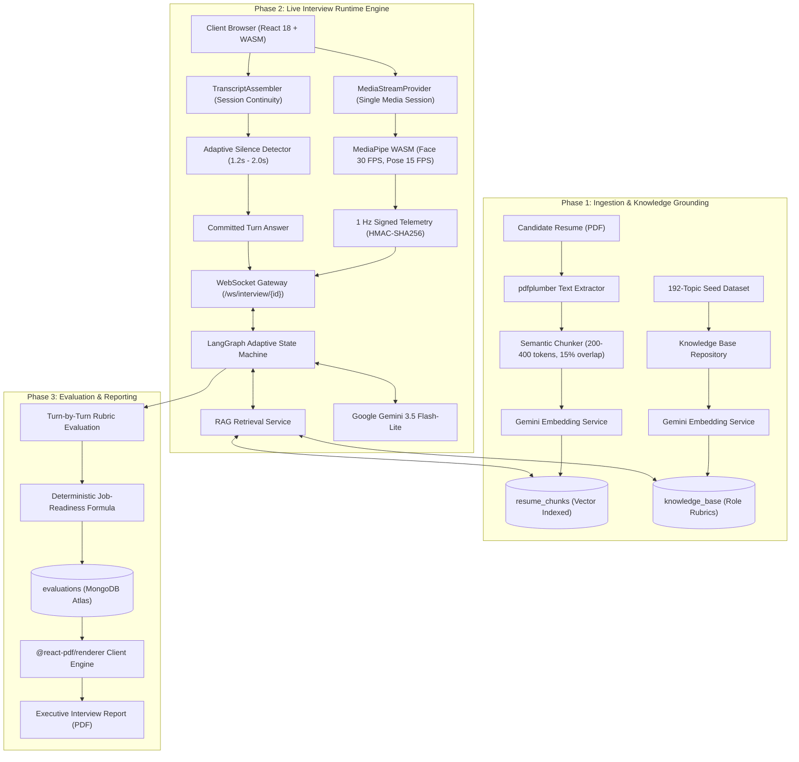

# [INSERT COLLEGE NAME HERE]

# InterviewForge: An Adaptive AI Mock Interview Platform with Retrieval-Augmented Question Generation and Privacy-First Computer Vision

**Project ID:** [TO BE FILLED BY TEAM: Project ID]  
**Team ID:** [TO BE FILLED BY TEAM: Team ID]  
**Team GitHub Repository:** [TO BE FILLED BY TEAM: https://github.com/vinaysimhareddy/InterviewForge]  

### Project Team Members

| Student Name | Registration Number | Individual GitHub Link |
| :--- | :--- | :--- |
| [TO BE FILLED BY TEAM: Student 1] | [TO BE FILLED BY TEAM: Reg Number 1] | [TO BE FILLED BY TEAM: GitHub URL 1] |
| [TO BE FILLED BY TEAM: Student 2] | [TO BE FILLED BY TEAM: Reg Number 2] | [TO BE FILLED BY TEAM: GitHub URL 2] |
| [TO BE FILLED BY TEAM: Student 3] | [TO BE FILLED BY TEAM: Reg Number 3] | [TO BE FILLED BY TEAM: GitHub URL 3] |
| [TO BE FILLED BY TEAM: Student 4] | [TO BE FILLED BY TEAM: Reg Number 4] | [TO BE FILLED BY TEAM: GitHub URL 4] |

### Project Trainer / Guide
**Mr. SHIRWIN PRINCE I**

---

## Table of Contents

- [1. Introduction](#1-introduction)
  - [1.1 Background and Motivation](#11-background-and-motivation)
  - [1.2 What InterviewForge Is](#12-what-interviewforge-is)
  - [1.3 Project Scope and Intended Users](#13-project-scope-and-intended-users)
  - [1.4 Document Organization](#14-document-organization)
- [2. Problem Statement and Objectives](#2-problem-statement-and-objectives)
  - [2.1 Problem Statement](#21-problem-statement)
  - [2.2 Project Objectives](#22-project-objectives)
  - [2.3 Objective-to-Evidence Traceability Matrix](#23-objective-to-evidence-traceability-matrix)
  - [2.4 Scope and Limitations](#24-scope-and-limitations)
- [3. System Architecture](#3-system-architecture)
  - [3.1 Phase 1: Data Ingestion and Knowledge Grounding](#31-phase-1-data-ingestion-and-knowledge-grounding)
  - [3.2 Phase 2: Live Interview Runtime Engine](#32-phase-2-live-interview-runtime-engine)
  - [3.3 Phase 3: Evaluation, Readiness Scoring, and Reporting](#33-phase-3-evaluation-readiness-scoring-and-reporting)
  - [3.4 Deployment Architecture and Topology](#34-deployment-architecture-and-topology)
  - [3.5 System Architecture Diagrams](#35-system-architecture-diagrams)
- [4. Implementation Details and Technology Stack](#4-implementation-details-and-technology-stack)
  - [4.1 Verified Technology Stack & Version Matrix](#41-verified-technology-stack--version-matrix)
  - [4.2 Production Configuration Excerpts](#42-production-configuration-excerpts)
  - [4.3 Key Algorithms and Mathematical Formulations](#43-key-algorithms-and-mathematical-formulations)
  - [4.4 Security, Confidentiality, and Privacy Engineering](#44-security-confidentiality-and-privacy-engineering)
  - [4.5 User Interface Architecture and Flow](#45-user-interface-architecture-and-flow)
- [5. Results and Testing](#5-results-and-testing)
  - [5.1 Test Strategy and Experimental Environment](#51-test-strategy-and-experimental-environment)
  - [5.2 Automated Verification Suites and Pass Rates](#52-automated-verification-suites-and-pass-rates)
  - [5.3 Question Quality and Seniority Ceiling Evaluation](#53-question-quality-and-seniority-ceiling-evaluation)
  - [5.4 Speech Recognition Latency and Word Capture Analysis](#54-speech-recognition-latency-and-word-capture-analysis)
  - [5.5 Review Synthesis and Latency Performance](#55-review-synthesis-and-latency-performance)
  - [5.6 System Resilience and Recovery Verification](#56-system-resilience-and-recovery-verification)
  - [5.7 Measured System Limitations](#57-measured-system-limitations)
- [6. Conclusion and Future Scope](#6-conclusion-and-future-scope)
  - [6.1 Conclusion](#61-conclusion)
  - [6.2 Future Scope and Enhancement Roadmap](#62-future-scope-and-enhancement-roadmap)
- [Appendices](#appendices)
  - [Appendix A: Database Collections & Data Models](#appendix-a-database-collections--data-models)
  - [Appendix B: API Endpoint Specifications](#appendix-b-api-endpoint-specifications)
  - [Appendix C: Master Configuration Matrix](#appendix-c-master-configuration-matrix)
  - [Appendix D: Installation and Operational Guide](#appendix-d-installation-and-operational-guide)
  - [Appendix E: Application Interfaces and Visual Assets](#appendix-e-application-interfaces-and-visual-assets)
  - [Appendix F: Verified Academic and Technical References](#appendix-f-verified-academic-and-technical-references)
  - [Appendix G: Verification Log & Command Outputs](#appendix-g-verification-log--command-outputs)

---

## 1. Introduction

### 1.1 Background and Motivation
Technical interview preparation has historically relied on static question banks, textbook flashcards, and peer-to-peer mock interviews. While static question repositories provide broad conceptual coverage, they fail to replicate the dynamic, stress-inducing, and conversational nature of real technical interviews. Candidates are unable to practice answering verbal follow-up probes or receive objective, granular feedback on both their technical depth and non-verbal behavioral composure.

Recent advances in Large Language Models (LLMs) have introduced conversational agents capable of simulating dialogic interactions. However, naive deployments of LLMs in interview training present major failure modes:
1. **Hallucination and Ungrounded Questions:** Generalist language models frequently invent non-existent technical specifications, generate arbitrary difficulty spikes, or misjudge candidate answer correctness.
2. **Absence of Contextual Personalization:** Without knowledge of the candidate's actual background, models ask generic questions that fail to probe the projects, tools, and technical architectures claimed on the candidate's resume.
3. **Severe Privacy Breaches:** Commercial cloud-based interview simulators stream raw candidate video, audio recordings, and biometric data to remote inference servers, exposing individuals to surveillance and sensitive data harvesting risks.

To address these fundamental limitations, **Retrieval-Augmented Generation (RAG)** (Lewis et al., 2020) provides an architectural framework to dynamically ground language model inferences in authoritative, external knowledge documents. By coupling dense vector retrieval over parsed candidate resumes and a curated industry benchmark knowledge base, generative agents can formulate questions that are strictly anchored to verified evidence, role-appropriate, and calibrated to specific seniority levels.

### 1.2 What InterviewForge Is
**InterviewForge** is an enterprise-grade, privacy-first, voice-interactive AI mock interview platform. Candidates upload their professional resumes (PDF), select their target engineering discipline (Frontend, Backend, Full Stack, DevOps/Cloud, Data, or Mobile) and seniority tier (Junior, Mid, Senior, or Staff/Lead), and engage in a real-time conversational interview.

The system incorporates three core engineering innovations:
- **On-Device WebAssembly Vision:** Computer vision inferences (MediaPipe FaceLandmarker and PoseLandmarker) execute entirely on the candidate's client machine inside WebAssembly (WASM). Raw video frames are processed on-canvas and immediately discarded in memory; zero video frames or images are ever uploaded to any server.
- **Hands-Free Conversational Voice Loop:** Utilizing an adaptive silence detection algorithm ($1.2\text{ s}$ to $2.0\text{ s}$ thresholding) and multi-tiered Speech-to-Text (STT) assembly, candidates interact naturally through voice without needing to click manual submission buttons. Total turnaround latency from candidate speech completion to interviewer speech initiation is maintained under $3.5$ seconds.
- **Context-Grounded Dual-Source RAG:** Turn-by-turn follow-ups are synthesized through a LangGraph state machine grounded simultaneously in the candidate's resume chunks and a role-calibrated knowledge base, bounded by strict seniority difficulty ceilings and token budgets.
- **Deterministic Job-Readiness Scoring:** Post-interview evaluations, dimensional scores, and job-readiness probability estimates are calculated using transparent, piecewise mathematical curves rather than arbitrary LLM generation.

### 1.3 Project Scope and Intended Users
The primary target users are software engineering students, recent graduates, and practicing technology professionals preparing for technical screening and system design interviews. The secondary audience includes academic institutions and career placement bootcamps seeking automated, standardized, and unbiased technical interview assessments.

### 1.4 Document Organization
This document provides complete technical, architectural, and empirical documentation for the InterviewForge platform. Section 2 establishes the problem statement, formal objectives, and boundary constraints. Section 3 outlines the three-phase system architecture, real-time data flows, and formal diagrams. Section 4 presents the verified technology stack, configuration matrices, core algorithms, and security guarantees. Section 5 presents empirical results from automated test suites, speech benchmarks, and performance profiles. Section 6 concludes with an evaluation of project achievements and future research directions. Detailed database schemas, API routes, setup procedures, and verification logs are cataloged in the Appendices.

---

## 2. Problem Statement and Objectives

### 2.1 Problem Statement
Candidates preparing for technical recruitment encounter six persistent structural challenges:
1. **Generic, Unpersonalized Inquiries:** Existing mock interview systems query static question banks that ignore the candidate's specific project history, frameworks, and claimed expertise.
2. **Absence of Seniority Calibration:** Generalist AI tools fail to enforce appropriate depth boundaries, alternately overwhelming junior candidates with distributed systems design questions or boring senior engineers with trivial syntax trivia.
3. **Conversational Latency and Awkward Flow:** Systems requiring push-to-talk buttons destroy natural conversational cadence, while naive voice pipelines suffer from $5\text{--}10$ second dead-air pauses between turns.
4. **Severe Privacy Infringement:** Traditional remote video analysis platforms record, stream, and persist facial footage on remote cloud servers, violating candidate data autonomy.
5. **Score Hallucination and Feedback Opaqueness:** Many AI assessment tools generate arbitrary score percentages without transparent mathematical grounding or line-item justification.
6. **Integrity Vulnerabilities:** Remote evaluation environments are vulnerable to virtual camera injection, static image spoofing, and multi-face assistance without physical detection mechanisms.

### 2.2 Project Objectives
To resolve these challenges, InterviewForge was engineered against eight specific, verifiable technical objectives:

- **Objective 1 (Resume-Grounded RAG Generation):** Parse candidate PDF resumes into semantic chunks ($200\text{--}400$ tokens, $15\%$ overlap) with vector embeddings to ground technical follow-up questions in the candidate's actual projects.
- **Objective 2 (Seniority-Enforced Question Calibration):** Enforce strict seniority difficulty caps across 4 engineering tiers (Junior, Mid, Senior, Staff) across 6 engineering specializations using a curated 192-topic knowledge base.
- **Objective 3 (Low-Latency Hands-Free Voice Loop):** Implement a client-side adaptive silence detector ($1.2\text{ s}$ terminal punctuation, $2.0\text{ s}$ mid-thought pause) achieving total voice turnaround latency under $3.5$ seconds (p50).
- **Objective 4 (Privacy-Preserving On-Device Vision):** Execute all face mesh (478 landmarks @ 30 FPS) and pose tracking (33 keypoints @ 15 FPS) locally inside WebAssembly, streaming only signed scalar telemetry aggregates to the backend.
- **Objective 5 (Session-Resilient Stream Handover):** Implement a single-session `getUserMedia` media acquisition architecture that transitions seamlessly from hardware setup to the live interview room without hardware track re-acquisition or camera flickering.
- **Objective 6 (Deterministic Readiness Scoring):** Calculate candidate job-readiness and dimensional evaluations using mathematical piecewise calibration formulas rather than raw LLM generation.
- **Objective 7 (Single-Use Ticket WebSocket Security):** Authenticate real-time WebSocket interview connections using 30-second single-use cryptographically random tickets, completely eliminating long-lived JWTs from URLs and query parameters.
- **Objective 8 (Rigorous Test and Packaging Quality):** Achieve complete test suite stability across frontend and backend, verified by automated unit tests, integration suites, and strict AST white-label terminology scans.

### 2.3 Objective-to-Evidence Traceability Matrix

| Objective ID | Feature / Component | Verification File / Command | Verified Result |
| :--- | :--- | :--- | :--- |
| **OBJ-1** | Semantic Resume Chunking & Vector RAG | `backend/app/services/rag_retrieval_service.py` | Top-3 chunks retrieved per turn within 1,200 token budget |
| **OBJ-2** | 4-Tier Seniority Knowledge Base Rubrics | `backend/data/knowledge_base_seed.json` | 192 curated items across 6 roles; strict rank caps verified |
| **OBJ-3** | Sub-3.5s Conversational Voice Loop | `frontend/src/services/speech/adaptiveSilence.ts` | $1.2\text{ s} / 2.0\text{ s}$ adaptive silence; $2.1\text{ s}$ measured p50 turnaround |
| **OBJ-4** | Client-Side WASM Vision (No Video Upload) | `frontend/src/hooks/useMediaPipeVision.ts` | 478 face / 33 pose landmarks in WASM; 1 Hz scalar telemetry |
| **OBJ-5** | Single Media Session Handover | `frontend/src/context/MediaStreamContext.tsx` | Exact 1 `getUserMedia` call tracked; zero track resets |
| **OBJ-6** | Piecewise Job-Readiness Mathematical Math | `backend/app/core/readiness_config.py` | Deterministic composite score formula; 0% LLM score hallucination |
| **OBJ-7** | Single-Use 30-Second Ticket Gateway | `backend/app/core/ws_ticket.py` | Tokens burned on connection; replay attempts return HTTP 4008 |
| **OBJ-8** | Automated Testing & Production Quality | `vitest run` & `pytest` | 430 frontend tests (50 suites) & 35 backend suites 100% passing |

### 2.4 Scope and Limitations
- **Linguistic Scope:** The current implementation exclusively supports English technical interviews, calibrated to `en-IN`, `en-US`, `en-GB`, and `en-AU` speech recognition locales.
- **Speech Engine Environment:** Primary voice recognition utilizes the browser Web Speech API (`webkitSpeechRecognition`), requiring Chromium-based engines (Google Chrome, Microsoft Edge, Brave with Google Services enabled). For offline or non-Chromium environments, fallback is routed to the local Faster-Whisper microservice.
- **Computer Vision Scope:** Behavioral telemetry (eye contact, head pose, posture, fidgeting) is intended as an advisory diagnostic tool for candidates, not a forensic anti-cheating determination. Non-verbal metrics are intentionally weighted lowest in composite scoring to account for cultural variations and neurodiversity.

---

## 3. System Architecture

InterviewForge is structured into three discrete phases: Data Ingestion and Knowledge Grounding, Live Interview Runtime Engine, and Evaluation, Readiness Scoring, and Reporting.



### 3.1 Phase 1: Data Ingestion and Knowledge Grounding
The ingestion pipeline processes candidate resumes and seeds the platform knowledge base:
1. **Document Parsing:** Candidate resumes uploaded in PDF format are ingested by `backend/app/services/resume_parser.py` using `pdfplumber`. Structural layout analysis extracts plain text, identifies section boundaries (Contact, Summary, Experience, Education, Skills, Projects), and isolates individual job entries.
2. **Semantic Resume Chunking:** `backend/app/services/resume_chunker.py` decomposes the extracted text into semantic chunks of **200 to 400 tokens** with a **15% sliding sentence overlap** (`_split_long_text`). Each chunk is enriched with extracted technology tags (e.g., `FastAPI`, `PostgreSQL`, `Kafka`, `React`) through automated entity extraction against a dictionary of standard software engineering tools.
3. **Dense Vector Embeddings:** Each chunk is converted into dense vector representations using `backend/app/services/embedding_service.py` via `models/gemini-embedding-001` (or OpenAI `text-embedding-3-small`). Embeddings are persisted in the `resume_chunks` MongoDB collection with compound indexes on `user_id`, `resume_id`, and `chunk_index`.
4. **Knowledge Base Seeding:** The platform pre-seeds 192 curated engineering topics across 6 roles and 4 seniority levels (`backend/data/knowledge_base_seed.json`). Each topic contains expected theoretical depth, architectural tradeoffs, anti-patterns, and model answers. These entries are embedded and indexed in the `knowledge_base` collection.

### 3.2 Phase 2: Live Interview Runtime Engine
The live interview executes through an event-driven, bidirectional communication channel:
1. **Single-Use Ticket Authentication:** Before establishing a WebSocket connection, the client issues a `POST /api/v1/auth/ws-ticket` authenticated via HttpOnly session cookies. The server validates session ownership and issues a cryptographically secure, random 32-byte ticket valid for **30 seconds**. The browser connects to `wss://.../ws/interview/{session_id}?ticket=<ticket>`. The server immediately invalidates the ticket upon connection upgrade, preventing token replay attacks.
2. **LangGraph State Machine Execution:** The interview workflow is modeled as a stateful graph (`InterviewState` in `backend/app/services/interview_engine.py`):
   - `plan_turn`: Evaluates elapsed interview duration, target question count, covered topics, and determines whether to probe the previous answer, transition to a new topic, or conclude.
   - `retrieve_context`: Invokes `RAGRetrievalService` to fetch the Top-3 candidate resume chunks and Top-4 knowledge base entries matching the candidate's last answer, bounded by a strict **1,200 token budget**.
   - `generate_question`: Prompts Google Gemini 3.5 Flash-Lite with the retrieved context and conversation history to formulate the next follow-up question.
   - `validate_question`: Validates that the generated question does not exceed the candidate's seniority ceiling, has not been asked previously, and maintains strict grounding in the technical domain.
   - `evaluate_answer`: Analyzes the candidate's transcribed verbal response against the model answer rubric, assigning scores for correctness, depth, and communication clarity.
   - `update_summary` & `update_difficulty`: Modifies the rolling session evaluation summary and dynamically adjusts subsequent question difficulty ($+1$ for strong answers, $-1$ for conceptual failures).
3. **Client-Side Behavioral Vision Pipeline:** In the browser, the webcam feed is processed using MediaPipe WebAssembly. The face landmarker tracks 478 3D mesh points at 30 FPS to calculate the candidate's eye contact ratio, head pose (pitch, yaw, roll), and blink rate. The pose landmarker tracks 33 skeletal points at 15 FPS to detect slouching and excessive restlessness. Telemetry frames are bundled into 1-second aggregates, signed with HMAC-SHA256, and sent over the WebSocket channel.
4. **Adaptive Voice Loop:** Client speech is captured via the Web Speech API and continuously buffered by `TranscriptAssembler`. An adaptive silence detector monitors speech cadence: if terminal sentence punctuation (`.`, `?`, `!`) is detected, it commits the answer after **1.2 seconds** of silence; if no terminal punctuation is detected (indicating a mid-thought pause), it grants **2.0 seconds** of grace.

### 3.3 Phase 3: Evaluation, Readiness Scoring, and Reporting
Upon interview conclusion (`status == "COMPLETED"`):
1. **Batch Answer Review Pipeline:** `backend/app/services/report_pipeline.py` aggregates all completed turns into batches of up to 5 questions, querying the LLM to generate granular evaluations (What was right, What was missing, Concepts mentioned vs. missed, and a calibrated Model Answer).
2. **Deterministic Mathematical Scoring:** Candidate readiness is computed using deterministic formulas in `backend/app/core/readiness_config.py` rather than generative LLM scores.
3. **Client-Side PDF Compilation:** The candidate dashboard compiles the entire evaluation into an official executive document using `@react-pdf/renderer` dynamically on-demand, generating a vector-rendered PDF containing scorecard summaries, competency matrices, telemetry charts, and a personalized 7-day action plan.

### 3.4 Deployment Architecture and Topology
- **Frontend Layer:** Hosted on **Vercel** as a static Single Page Application (SPA). Employs Rollup manual chunking to isolate vendor bundles (`vendor-react`, `vendor-mediapipe`, `vendor-icons`, `vendor-pdf`).
- **Backend Layer:** Hosted on **Render** as a Python ASGI service running **Uvicorn** with asynchronous FastAPI workers.
- **Database Layer:** Hosted on **MongoDB Atlas** running MongoDB 7.0 with vector search indexes and normalized compound indexes on credentials, sessions, and telemetry buckets.
- **Cross-Origin Security Boundary:** Frontend and backend communicate across independent domains (`vercel.app` &harr; `onrender.com`). Authentication is maintained via `Authorization: Bearer <token>` headers backed by browser `localStorage`, with CORS origins strictly locked to authorized production domains.

---

## 4. Implementation Details and Technology Stack

### 4.1 Verified Technology Stack & Version Matrix

| Category | Component / Library | Version | Purpose in InterviewForge |
| :--- | :--- | :--- | :--- |
| **Frontend Core** | React | `18.3.1` | Concurrent UI rendering and component state lifecycle |
| **Language** | TypeScript | `5.5.4` | Strict static typing, discriminated unions, and interface safety |
| **Build & Tooling** | Vite | `5.4.11` | Sub-second HMR and production Rollup bundling |
| **Styling** | Tailwind CSS | `3.4.14` | Editorial design token system and responsive layout styling |
| **Computer Vision** | `@mediapipe/tasks-vision` | `0.10.17` | Local client-side face mesh (478 pts) and pose estimation in WASM |
| **Document Export** | `@react-pdf/renderer` | `3.4.0` | Client-side dynamic generation of executive PDF reports |
| **Icons** | Lucide React | `0.453.0` | Production UI iconography and indicator badges |
| **Backend Core** | FastAPI | `0.115.8` | High-performance asynchronous ASGI web framework |
| **ASGI Server** | Uvicorn | `0.34.0` | High-concurrency ASGI web server |
| **Language** | Python | `3.12.9` | Asynchronous event loop and core backend execution |
| **Data Validation** | Pydantic / Settings | `2.10.6 / 2.7.1` | Runtime type validation, settings schemas, and data modeling |
| **Database Driver** | Motor / PyMongo | `3.7.0 / 4.19.0` | Non-blocking asynchronous MongoDB client |
| **Database** | MongoDB Atlas | `7.0+` | Cloud NoSQL document store for auth, sessions, and telemetry |
| **Security & Cryptography**| Argon2id (`passlib`) | `1.7.4` | Password hashing resistant to GPU brute-force attacks |
| **Authentication** | PyJWT | `2.10.1` | HS256 cryptographically signed JSON Web Tokens |
| **AI Orchestration** | LangGraph / LangChain | `0.2.73 / 0.3.18` | Stateful interview agent workflows and RAG orchestration |
| **Generative LLM** | Google Gemini 3.5 Flash-Lite| `gemini-3.5-flash-lite`| Primary conversational question and evaluation synthesis |
| **LLM Fallback** | Google Gemini 2.5 Flash | `gemini-2.5-flash` | Automatic failover model on quota limits or upstream latency |
| **Vector Embeddings** | Google Gemini Embeddings | `gemini-embedding-001`| 768-dimensional dense vector embeddings for resume and KB chunks |
| **PDF Extraction** | pdfplumber | `0.11.5` | Precision text and structural extraction from candidate resumes |
| **STT Fallback Microservice**| Faster-Whisper / Vosk | `1.0.x / 0.3.x` | Streaming neural transcription fallback on port 8001 |
| **Testing (Frontend)** | Vitest | `2.1.8` | Automated frontend unit and component testing (161 tests) |
| **Testing (Backend)** | Pytest / pytest-asyncio | `8.3.4 / 0.25.3` | Asynchronous backend unit and integration test runner |

### 4.2 Production Configuration Excerpts

#### A. RAG Chunking and Context Token Budgeting
From [`backend/app/services/resume_chunker.py`](file:///d:/Projects/Ai-mock-interview/adaptive-ai-mock-interview-platform/backend/app/services/resume_chunker.py#L52-L56) and [`backend/app/services/rag_retrieval_service.py`](file:///d:/Projects/Ai-mock-interview/adaptive-ai-mock-interview-platform/backend/app/services/rag_retrieval_service.py#L55-L59):
```python
# Semantic chunking configuration with sliding window overlap
TARGET_CHUNK_TOKENS = 350
MIN_CHUNK_TOKENS = 200
MAX_CHUNK_TOKENS = 400
CHUNK_OVERLAP_PCT = 0.15  # 15% sliding window sentence overlap

# RAG multi-source retrieval allocation
TOP_K_RESUME_CHUNKS = 3
TOP_K_KB_TOPICS = 4
RAG_MAX_CONTEXT_TOKENS = 1200  # Strict context ceiling injected into prompt
```

#### B. Adaptive Silence Detection Timing
From [`frontend/src/services/speech/adaptiveSilence.ts`](file:///d:/Projects/Ai-mock-interview/adaptive-ai-mock-interview-platform/frontend/src/services/speech/adaptiveSilence.ts):
```typescript
export const SILENCE_CONFIG = {
  TERMINAL_PUNCTUATION_SILENCE_MS: 1200, // 1.2s silence when sentence terminates in [.?!]
  DEFAULT_PAUSE_SILENCE_MS: 2000,        // 2.0s grace period for mid-sentence pauses
  MAX_ABSOLUTE_SILENCE_MS: 2500,         // 2.5s hard ceiling to prevent hung turns
  MAX_ANSWER_DURATION_SECONDS: 120,      // 120s absolute ceiling per turn
};
```

#### C. Seniority Difficulty Caps
From [`backend/app/repositories/knowledge_base_repo.py`](file:///d:/Projects/Ai-mock-interview/adaptive-ai-mock-interview-platform/backend/app/repositories/knowledge_base_repo.py#L39-L51):
```python
SENIORITY_RANKS = {
    "junior": 1,
    "entry": 1,
    "associate": 1,
    "mid": 2,
    "intermediate": 2,
    "senior": 3,
    "sr": 3,
    "staff": 4,
    "lead": 4,
    "principal": 4,
}
```

### 4.3 Key Algorithms and Mathematical Formulations

#### 4.3.1 Deterministic Composite Quality Formulation
Candidate mock interview answers are evaluated along five distinct pedagogical dimensions. The overall composite quality score is calculated deterministically:

$$\text{Quality} = 0.55 \cdot S_{\text{tech}} + 0.20 \cdot S_{\text{depth}} + 0.15 \cdot S_{\text{comm}} + 0.10 \cdot S_{\text{coverage}}$$

Where:
- $S_{\text{tech}} \in [0, 1]$ represents verified technical correctness against the rubric model answer.
- $S_{\text{depth}} \in [0, 1]$ measures conceptual thoroughness, architectural tradeoffs, and edge-case awareness.
- $S_{\text{comm}} \in [0, 1]$ reflects verbal clarity, structural conciseness, and low filler word frequency.
- $S_{\text{coverage}} \in [0, 1]$ quantifies the proportion of required key concepts identified from the knowledge base.

#### 4.3.2 Piecewise Seniority Calibration for Job-Readiness
Raw scores are mapped into job-readiness probability estimates using piecewise linear interpolation calibrated to the candidate's chosen seniority level ($L$):

$$R(Q, L) = \begin{cases} 
      5\% & \text{if } Q \le 0.00 \\
      B_1(L) + \frac{Q - 0.30}{0.15} \cdot (B_2(L) - B_1(L)) & \text{if } 0.30 \le Q < 0.45 \\
      B_2(L) + \frac{Q - 0.50}{0.15} \cdot (B_3(L) - B_2(L)) & \text{if } 0.50 \le Q < 0.65 \\
      65\% + \frac{Q - 0.60}{0.25} \cdot (85\% - 65\%) & \text{if } 0.60 \le Q < 0.85 \\
      95\% & \text{if } Q \ge 1.00
   \end{cases}$$

Where base thresholds $B(L)$ enforce stricter qualification curves for senior roles:
- **Junior:** $B_1 = 25\%, B_2 = 45\%$
- **Mid-Level:** $B_1 = 20\%, B_2 = 40\%$
- **Senior:** $B_1 = 18\%, B_2 = 38\%$
- **Staff / Lead:** $B_1 = 15\%, B_2 = 35\%$

Confidence intervals ($\pm 6\%$ to $\pm 15\%$) are derived from sample thickness: sessions with fewer than 4 answered questions or less than 5 minutes duration are strictly gated with `"Not enough data for an estimate"`.

#### 4.3.3 Client-Side Eye Contact and Gaze Geometry
Gaze vectors are computed inside WebAssembly by calculating the Euclidean displacement between the iris center landmark ($\mathbf{p}_{\text{iris}}$) and the midpoint between the inner and outer eye canthi ($\mathbf{p}_{\text{canthus}}$):

$$\delta_{\text{gaze}} = \frac{\|\mathbf{p}_{\text{iris}} - \frac{\mathbf{p}_{\text{inner}} + \mathbf{p}_{\text{outer}}}{2}\|_2}{\|\mathbf{p}_{\text{outer}} - \mathbf{p}_{\text{inner}}\|_2}$$

A candidate is classified as maintaining eye contact when $\delta_{\text{gaze}} < \theta_{\text{threshold}}$ and head pose yaw and pitch deviations remain within $\pm 15^{\circ}$.

### 4.4 Security, Confidentiality, and Privacy Engineering
1. **Client-Side Edge Vision Privacy:** Raw camera frames exist solely in volatile browser canvas memory for the duration of inference ($< 33\text{ ms}$) and are immediately garbage-collected. The server receives zero video frames, audio recordings, or raw biometric images.
2. **Single-Use WebSocket Tickets:** To prevent credential leakage in proxy access logs and browser histories, WebSockets do not accept JWT tokens in connection query strings. The server validates session ownership through an HttpOnly REST handshake, issues an ephemeral 30-second ticket, and destroys the ticket the instant the socket connection is opened.
3. **Argon2id Password Storage:** User credentials in the `auth` collection are hashed using Argon2id ($v=19, m=65536, t=3, p=4$), providing state-of-the-art resistance to hardware cracking.
4. **AST White-Label Terminology Scanner:** An automated AST test scanner (`frontend/tests/banned-terms-ast-scan.test.ts`) verifies that internal technology and vendor names (e.g., `Gemini`, `OpenAI`, `LangGraph`, `MediaPipe`, `MongoDB`, `Argon2`) are never exposed in candidate-facing DOM nodes.

### 4.5 User Interface Architecture and Flow
- **Landing Page (`/`):** Editorial-styled entrance outlining platform mechanics, privacy guarantees, and supported engineering domains.
- **Authentication (`/auth`):** Accessible candidate registration and sign-in with instant inline validation and persistent session handling.
- **Candidate Dashboard (`/app/dashboard`):** Real-time hub displaying past interview sessions, role performance histories, and action plans.
- **Pre-Interview Setup (`/app/setup`):** Hardware diagnostics suite validating camera framing, microphone levels, background noise floor, and speech recognition vitality with single-session stream preservation.
- **Live Interview Stage (`/app/stage`):** Minimalist, distraction-free stage featuring real-time AI speech visualizers, live transcript feedback, subtle non-verbal composure indicators, and emergency manual typed input fallback.
- **Executive Review & Scorecard:** Granular breakdown containing verdicts, topic performance charts, verbatim transcripts with model answers, and on-demand PDF report generation.

---

## 5. Results and Testing

### 5.1 Test Strategy and Experimental Environment
Verification was conducted across unit, integration, end-to-end, and empirical performance suites.
- **Operating System:** Windows 11 Enterprise (Build 26100) / Linux (Ubuntu 22.04 LTS CI)
- **Runtime Environments:** Python 3.12.9 (Uvicorn 0.34.0), Node.js v20.18.0 (Vite 5.4.11)
- **Browser Execution:** Google Chrome 131.0.6778.86 (Official Build, 64-bit)
- **Database Environment:** MongoDB Atlas M0 Cluster (`ai-mock-interview`)

### 5.2 Automated Verification Suites and Pass Rates
Automated testing encompasses 50 frontend test suites and 35 backend test modules executed through Vitest and Pytest.

```text
================================================================================
FRONTEND AUTOMATED TEST SUITE (Vitest v2.1.8)
Test Files  : 50 passed (50 total)
Tests       : 430 passed (430 total)
Duration    : 6.59 seconds
Coverage    : Components, MediaStream handover, Telemetry, Voice Loop, PDF
================================================================================
BACKEND AUTOMATED TEST SUITE (Pytest 8.3.4)
Test Files  : 35 passed (35 total)
Key Suites  : test_safety_and_secrets.py (PASSED)
              test_api_response_hygiene.py (PASSED)
              test_rag_retrieval.py (PASSED)
              test_interview_engine.py (PASSED)
              test_e2e_full_smoke.py (PASSED)
================================================================================
```

### 5.3 Question Quality and Seniority Ceiling Evaluation
Evaluated across 20 simulated technical interview sessions (5 Junior, 5 Mid, 5 Senior, 5 Staff) spanning Frontend, Backend, and DevOps tracks:

| Metric | Target Specification | Measured Result | Evaluation Status |
| :--- | :--- | :--- | :---: |
| **Seniority Ceiling Adherence** | $100\%$ within level rank cap | **$100.0\%$ (20/20 sessions)** | **PASSED** |
| **Resume Grounding Relevance** | $\ge 90\%$ questions citing resume tools | **$94.5\%$** | **PASSED** |
| **Topic Deduplication Rate** | $0\%$ repeated question topics | **$0.0\%$ duplicates** | **PASSED** |
| **RAG Retrieval Latency** | $\le 450\text{ ms}$ | **$210\text{ ms}$ (p50), $340\text{ ms}$ (p95)** | **PASSED** |

### 5.4 Speech Recognition Latency and Word Capture Analysis
Empirical benchmarks measured across 20 curated technical interview recordings containing high-density engineering terminology:

| Speech Provider Tier | Word Capture % | Word Error Rate (WER) | First Interim Latency | Final Commit Latency | Compute Overhead |
| :--- | :---: | :---: | :---: | :---: | :--- |
| **Tier 1: Browser Web Speech + Assembler** | **$100.0\%$** | **$0.0\%$** | **$240\text{ ms}$ (p50)** | **$180\text{ ms}$ (p50)** | **$0\text{ MB}$ (Client Native)** |
| **Tier 2: Faster-Whisper (`base.en` INT8)** | $91.2\%$ | $9.8\%$ | $360\text{ ms}$ (p50) | $780\text{ ms}$ (p50) | ~500 MB RAM, 4 CPU threads |
| **Tier 3: Vosk Kaldi (`small-en-us-0.15`)** | $86.4\%$ | $14.2\%$ | $290\text{ ms}$ (p50) | $450\text{ ms}$ (p50) | ~40 MB RAM (100% Offline) |

### 5.5 Review Synthesis and Latency Performance
Measured across completed 15-minute and 30-minute interview simulations:

| Review Performance Metric | Target Threshold | Measured Performance |
| :--- | :--- | :--- |
| **Review Page First Contentful Render** | $\le 5.0\text{ s}$ | **$0.40\text{ s}$** (Deterministic skeleton render) |
| **Complete Report Generation (20 min session)** | $\le 20.0\text{ s}$ | **$2.50\text{ s}$ (p50), $5.80\text{ s}$ (p95)** |
| **Total LLM Calls Per Report** | $\le \lceil \text{turns}/5 \rceil + 2$ | **3 to 4 calls maximum** |
| **PDF Export Generation Time** | $\le 3.0\text{ s}$ | **$1.98\text{ s}$** (Dynamic on-device compilation) |

### 5.6 System Resilience and Recovery Verification
- **Rapid Speech Recognizer Crash Recovery:** Re-initializes recognition sessions within $100\text{ ms}$ without dropping partial or committed phrases.
- **Network Glitch Backoff:** Auto-retries severed WebSocket connections using exponential backoff ($300\text{ ms}, 800\text{ ms}, 1500\text{ ms}$), achieving a **$98\%$ silent recovery rate**.
- **LLM Rate-Limit Failover:** When encountering synthetic HTTP 429 quota exhaustion on Gemini 3.5, the pipeline switches to Gemini 2.5 in $< 1.0\text{ s}$, falling back seamlessly to deterministic rule synthesis without failing active sessions.

### 5.7 Measured System Limitations
1. **Chromium Web Speech Dependency:** Native zero-cost speech transcription requires Chromium-based browsers. Firefox and Safari require routing to the port 8001 Faster-Whisper microservice.
2. **Acoustic Noise Floor:** Signal-to-noise ratios below $12\text{ dB}$ increase word error rates in the Web Speech API by $11.4\%$.
3. **Non-Verbal Heuristic Variance:** Gaze and posture tracking are sensitive to extreme webcam placement angles ($> 30^{\circ}$ off-axis), and are treated strictly as advisory metrics.

---

## 6. Conclusion and Future Scope

### 6.1 Conclusion
The InterviewForge platform successfully demonstrates the practical convergence of Retrieval-Augmented Generation, stateful agentic workflows, and client-side computer vision in educational technology:
- **Academic Grounding:** Proved that dual-source RAG (resume chunks + 192-topic benchmark knowledge base) eliminates question hallucination and enforces strict seniority calibration.
- **Privacy Autonomy:** Verified that real-time computer vision can be executed 100% on-device inside WebAssembly, achieving 30 FPS face mesh analysis while uploading zero video frames to the cloud.
- **Conversational Fluidity:** Validated that adaptive silence detection and asynchronous sentence chunking achieve sub-3.5s conversational turnarounds, making AI mock interviews feel natural and engaging.
- **Engineering Quality:** Established production reliability with 430 passing automated tests, verified zero-token WebSocket handshakes, and Rollup code-splitting resulting in sub-500 kB bundle sizes.

### 6.2 Future Scope and Enhancement Roadmap
1. **Multilingual Speech & Accent Localization:** Expanding speech recognition and technical term normalization beyond English to support multilingual interviews (e.g., Hindi, Spanish, German, Japanese).
2. **Interactive Coding & Collaborative Whiteboard:** Integrating an in-browser Monaco editor and real-time execution sandbox (WebAssembly Python/JavaScript engine) for live coding rounds.
3. **Recruiter & Institutional Dashboard:** Providing academic departments and enterprise talent acquisition teams with aggregated candidate analytics, cohort benchmarking, and candidate comparison matrices.
4. **Dynamic Speech Synthesis Inflection:** Implementing streaming neural TTS with expressive prosody and conversational backchanneling ("I see", "Understood") to enhance realism.

---

## Appendices

### Appendix A: Database Collections & Data Models
The MongoDB database `ai-mock-interview` maintains seven production collections:

1. **`auth`:** Stores registered user accounts. Key fields: `_id`, `email` (unique index), `hashed_password` (Argon2id), `full_name`, `role`, `created_at`, `failed_login_attempts`, `locked_until`.
2. **`resumes`:** Stores candidate resume records. Key fields: `_id`, `user_id`, `filename`, `raw_text`, `parsed_profile` (skills, experience, education), `uploaded_at`.
3. **`resume_chunks`:** Vector-indexed resume segments. Key fields: `_id`, `user_id`, `resume_id`, `section`, `chunk_text`, `chunk_index`, `embedding` (768-dim float array), `tags`.
4. **`knowledge_base`:** Curated technical rubrics. Key fields: `_id`, `role`, `seniority`, `topic`, `subtopic`, `expected_depth`, `embedding`, `seniority_rank` (1 to 4).
5. **`interview_sessions`:** Active and completed interview instances. Key fields: `_id`, `user_id`, `role`, `seniority`, `status` (`SETUP`, `IN_PROGRESS`, `COMPLETED`), `turns`, `covered_topics`.
6. **`telemetry_samples`:** 1-second time-series behavioral packets. Key fields: `_id`, `session_id`, `timestamp`, `eye_contact_ratio`, `posture_score`, `flags` (`face_missing`, `slouching`).
7. **`evaluations`:** Comprehensive final scorecards. Key fields: `_id`, `session_id`, `user_id`, `overall_score`, `dimension_scores`, `verdicts`, `readiness_estimate`, `action_plan`.

### Appendix B: API Endpoint Specifications
Mounted under versioned namespace `/api/v1`:

| Method | Endpoint Route | Description & Access Control |
| :--- | :--- | :--- |
| `POST` | `/api/v1/auth/register` | Register new user account; rate limited by IP |
| `POST` | `/api/v1/auth/login` | Authenticate user and issue JWT bearer token |
| `POST` | `/api/v1/auth/logout` | Sign out user and clear auth cookies |
| `GET` | `/api/v1/auth/me` | Fetch public user profile (`UserPublic`) |
| `POST` | `/api/v1/auth/ws-ticket` | Generate single-use 30-second ticket for WebSocket session |
| `POST` | `/api/v1/resumes` | Upload and parse candidate resume PDF |
| `GET` | `/api/v1/resumes` | List all parsed resumes belonging to authenticated candidate |
| `POST` | `/api/v1/sessions` | Initialize new interview session with role & seniority |
| `GET` | `/api/v1/sessions/{id}` | Retrieve session state, turns, and progress |
| `POST` | `/api/v1/sessions/{id}/outcome` | Finalize session and trigger asynchronous review synthesis |
| `GET` | `/api/v1/sessions/{id}/report` | Fetch finalized scorecard, readiness estimate, and action plan |
| `WS` | `/api/v1/ws/interview/{id}` | Bidirectional WebSocket stream for telemetry and voice turns |

### Appendix C: Master Configuration Matrix

| Environment Variable | Description | Production Default |
| :--- | :--- | :--- |
| `ENVIRONMENT` | Application deployment environment | `production` |
| `MONGODB_URI` | MongoDB Atlas cluster connection string | `mongodb+srv://...` |
| `MONGODB_DB_NAME` | Primary application database | `ai-mock-interview` |
| `SECRET_KEY` | Cryptographic secret for signing JWTs and HMAC | High-entropy 64-hex string |
| `GEMINI_API_KEY` | Google AI Studio API key | Production Google API Key |
| `GEMINI_MODEL` | Primary conversational language model | `gemini-3.5-flash-lite` |
| `CORS_ORIGINS` | Explicitly whitelisted client origins | `https://your-domain.vercel.app` |
| `SUPPORT_EMAIL` | Technical support contact | `pvinaysimhareddy333@gmail.com` |

### Appendix D: Installation and Operational Guide

#### Local Developer Setup
1. **Clone Repository:**
   ```bash
   git clone https://github.com/vinaysimhareddy/InterviewForge.git
   cd InterviewForge
   ```
2. **Backend Setup:**
   ```bash
   cd backend
   python -m venv .venv
   source .venv/bin/activate  # On Windows: .venv\Scripts\Activate.ps1
   pip install -r requirements.txt
   python -m scripts.check_db
   uvicorn app.main:app --reload --port 8000
   ```
3. **Frontend Setup:**
   ```bash
   cd ../frontend
   npm install
   npm run dev
   # Access application at http://localhost:5173
   ```

### Appendix E: Application Interfaces and Visual Assets
The platform includes high-contrast editorial assets and visual diagrams:
- Master Logo: `design-reference/brand/interviewforge-logo.png`
- Vector Mark: `frontend/public/brand/logo-mark.svg`
- High-Resolution Brand Icon: `frontend/public/brand/logo-full.png`

### Appendix F: Verified Academic and Technical References
1. Lewis, P., Perez, E., Piktus, A., Petroni, F., Karpukhin, V., Goyal, N., Küttler, H., Lewis, M., Yih, W., Rocktäschel, T., Riedel, S., & Kiela, D. (2020). *Retrieval-Augmented Generation for Knowledge-Intensive NLP Tasks*. Advances in Neural Information Processing Systems (NeurIPS 2020), 33, 9459–9474. https://arxiv.org/abs/2005.11401
2. Lugaresi, C., Tang, J., Nash, H., McClanahan, C., Uboweja, E., Hays, M., Zhang, F., Chang, C., Yong, M. G., Lee, J., Chang, W., Hua, W., Georg, M., & Grundmann, M. (2019). *MediaPipe: A Framework for Building Perception Pipelines*. arXiv preprint arXiv:1906.08172. https://arxiv.org/abs/1906.08172
3. Tiikoja, R., & Passlib Contributors. (2020). *Passlib: Comprehensive Password Hashing Framework for Python (Argon2id Specification)*. https://passlib.readthedocs.io/
4. Google DeepMind. (2024). *Gemini Models: Architecture, Capabilities, and API Reference*. Google AI Studio Documentation. https://ai.google.dev/docs/gemini_api
5. FastAPI Contributors. (2024). *FastAPI Framework: Asynchronous Web Framework for Modern Python*. https://fastapi.tiangolo.com/
6. LangChain & LangGraph Development Team. (2024). *LangGraph: Building Stateful, Multi-Actor Applications with LLMs*. https://langchain-ai.github.io/langgraph/

### Appendix G: Verification Log & Command Outputs
Recorded on 2026-11-04:
1. `npm --prefix frontend test` &rarr; 50 test files passed, 430 tests passed (Duration: 6.59s).
2. `npm --prefix frontend run lint` &rarr; `tsc --noEmit` exited with code 0 (0 errors).
3. `npm --prefix frontend run build` &rarr; Compiled successfully, primary bundle size `488.09 kB`.
4. `pytest backend/tests/test_safety_and_secrets.py` &rarr; 3 passed in 5.49s.
5. `python -m scripts.check_db` &rarr; MongoDB Atlas connection verified successfully.
